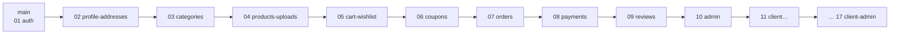

# ShopEase – Learning Build

A full online store (MERN: **M**ongoDB, **E**xpress, **R**eact, **N**ode.js), rebuilt **one module at a time** so you can learn how a real system is put together.

The finished store has a customer shop, a cart, checkout, payments, reviews and an admin panel. Here it is built step by step, starting with the most basic thing every app needs: **logging in (authentication)** and **permissions (authorization)**.

Every step is a git **branch**. Each branch holds everything from the step before, plus one new module. Each branch:

- installs, runs and passes all its tests on its own
- has beginner comments on almost every line of code
- has a doc for each folder, a module guide, a "how to think" mind map and concept docs
- has automated tests (Jest), plus Postman and Bruno collections you can click through

---

## Roadmap (stacked branches)

| # | Branch | Adds | Status |
|---|---|---|---|
| 01 | `main` | Authentication + authorization (register, login, JWT, roles, email verify, password reset, Google login) | ✅ done |
| 02 | `02-profile-addresses` | Profile editing, saved addresses (ownership checks) | ✅ done |
| 03 | `03-categories` | Categories (first admin-only CRUD, slugs) | ✅ done |
| 04 | `04-products-uploads` | Products, search/filter/pagination, image uploads (Cloudinary) | ✅ done |
| 05 | `05-cart-wishlist` | Cart and wishlist, price calculation | ✅ done |
| 06 | `06-coupons` | Discount coupons | ✅ done |
| 07 | `07-orders` | Orders: MongoDB transactions, stock reservation, status flow | ✅ done |
| 08 | `08-payments` | Stripe card payments + webhooks | ✅ done |
| 09 | `09-reviews` | Product reviews (only after delivery) | ✅ done |
| 10 | `10-admin` | Admin dashboard, reports, customer management | ⏳ planned |
| 11 | `11-client-foundation-auth` | React app foundation + auth pages | ⏳ planned |
| 12 | `12-client-account` | Account pages (profile, addresses) | ⏳ planned |
| 13 | `13-client-catalog` | Shop, categories, product pages | ⏳ planned |
| 14 | `14-client-cart-wishlist` | Cart and wishlist pages | ⏳ planned |
| 15 | `15-client-checkout-orders` | Checkout and order pages | ⏳ planned |
| 16 | `16-client-reviews` | Reviews UI | ⏳ planned |
| 17 | `17-client-admin` | Admin panel UI | ⏳ planned |



To see exactly what one step added: `git diff main..02-profile-addresses`.

---

## Quick start

You need: **Node.js 20+**, **Docker Desktop** (for Mailpit), and a **MongoDB Atlas** connection string.
Full step-by-step guide: [docs/guides/setup-local.md](docs/guides/setup-local.md).

```bash
# 1) Start Mailpit (fake email inbox) from the repo root
docker compose up -d                 # inbox → http://localhost:8025

# 2) Install the API
cd server
npm install

# 3) Create your .env and fill in MONGO_URI + JWT_SECRET
cp .env.example .env                 # PowerShell: Copy-Item .env.example .env

# 4) Create the admin account (uses ADMIN_* from .env)
npm run seed:admin

# 5) Start the API
npm run dev                          # → http://localhost:5000/api/health
```

Then open **http://localhost:5000/api/docs** to see and try every endpoint (Swagger UI).

> **npm 11 note.** npm now blocks package install scripts unless you approve them.
> `server/package.json` already approves the two we need under `"allowScripts"`:
> `bcrypt` (password hashing, native code) and `mongodb-memory-server` (test database).
> Other "install-scripts" warnings (`@parcel/watcher`, `@scarf/scarf`) are safe to ignore.

---

## npm scripts (run inside `server/`)

| Command | What it does |
|---|---|
| `npm run dev` | Start the API with **nodemon** (restarts when you save a file) |
| `npm start` | Start the API with plain node (production style) |
| `npm run seed:admin` | Create the admin user from `ADMIN_*` in `.env` (safe to run twice) |
| `npm run db:indexes` | Make MongoDB indexes match the schemas (use in production) |
| `npm test` | Run all Jest tests (unit + integration, in-memory DB) |
| `npm run test:unit` | Only unit tests (`tests/unit`) |
| `npm run test:integration` | Only integration tests (`tests/integration`) |
| `npm run test:coverage` | All tests + coverage report (fails under 90% lines) |
| `npm run test:watch` | Re-run tests when files change |
| `npm run test:api` | Run the **Postman** collection with Newman (server + Mailpit must be running) |
| `npm run test:bruno` | Run the **Bruno** collection with the Bruno CLI (server + Mailpit must be running) |
| `npm run lint` | Check code with ESLint |
| `npm run lint:fix` | Auto-fix what ESLint can |
| `npm run format` | Format all files with Prettier |
| `npm run format:check` | Check formatting without changing files (used by CI) |

---

## Docs map

**Start here:** [docs/00-start-here.md](docs/00-start-here.md)

**Concepts** (engineering basics, in simple words)
1. [How the web works](docs/concepts/01-how-the-web-works.md)
2. [Layered architecture](docs/concepts/02-layered-architecture.md)
3. [Authentication vs authorization](docs/concepts/03-authentication-vs-authorization.md)
4. [Passwords and hashing](docs/concepts/04-passwords-and-hashing.md)
5. [JWT and sessions](docs/concepts/05-jwt-and-sessions.md)
6. [Validation and trust](docs/concepts/06-validation-and-trust.md)
7. [Error handling](docs/concepts/07-error-handling.md)
8. [Security basics](docs/concepts/08-security-basics.md)
9. [Config and environments](docs/concepts/09-config-and-environments.md)
10. [Databases and indexes](docs/concepts/10-databases-and-indexes.md)
11. [Testing strategy](docs/concepts/11-testing-strategy.md)
12. [API design and docs](docs/concepts/12-api-design-and-docs.md)
13. [System design baseline](docs/concepts/13-system-design-baseline.md)
14. [Ownership: resource-level authorization (IDOR)](docs/concepts/14-authorization-ownership.md)
15. [Slugs, and public vs admin APIs](docs/concepts/15-slugs-and-public-vs-admin-apis.md)
16. [Catalog queries: pagination, filtering, sorting, text search, indexes, stock](docs/concepts/16-catalog-queries.md)
17. [File uploads, multipart and a CDN (Cloudinary)](docs/concepts/17-file-uploads-and-cdn.md)
18. [Transactions, atomic updates, upserts and idempotency](docs/concepts/18-transactions-and-atomic-updates.md)
19. [Coupons: money math, validity windows and atomic counters](docs/concepts/19-coupons-money-math-and-atomic-counters.md)
20. [Transactions, ACID and race conditions](docs/concepts/20-transactions-and-race-conditions.md)
21. [State machines and snapshots](docs/concepts/21-state-machines-and-snapshots.md)
22. [Webhooks, signatures and idempotency](docs/concepts/22-webhooks-signatures-idempotency.md)
23. [Ratings: aggregation pipelines, denormalized counters, compound unique indexes, moderation](docs/concepts/23-ratings-aggregation-moderation.md)
- [Glossary](docs/concepts/glossary.md)

**Mind maps** (how to think while building)
- [How to think about any module](docs/mind-maps/00-how-to-think.md)
- [01 – Auth](docs/mind-maps/01-auth.md)
- [02 – Profile & Addresses](docs/mind-maps/02-profile-addresses.md)
- [03 – Categories](docs/mind-maps/03-categories.md)
- [04 – Products & Uploads](docs/mind-maps/04-products-uploads.md)
- [05 – Cart & Wishlist](docs/mind-maps/05-cart-wishlist.md)
- [06 – Coupons](docs/mind-maps/06-coupons.md)
- [07 – Orders](docs/mind-maps/07-orders.md)
- [08 – Payments](docs/mind-maps/08-payments.md)
- [09 – Reviews](docs/mind-maps/09-reviews.md)

**Modules**
- [01 – Auth](docs/modules/01-auth.md)
- [02 – Profile & Addresses](docs/modules/02-profile-addresses.md)
- [03 – Categories](docs/modules/03-categories.md)
- [04 – Products & Uploads](docs/modules/04-products-uploads.md)
- [05 – Cart & Wishlist](docs/modules/05-cart-wishlist.md)
- [06 – Coupons](docs/modules/06-coupons.md)
- [07 – Orders](docs/modules/07-orders.md)
- [08 – Payments](docs/modules/08-payments.md)
- [09 – Reviews](docs/modules/09-reviews.md)

**Testing**
- [Testing guide (Jest, Postman/Newman, Bruno)](docs/testing/README.md)

**Guides**
- [Local setup (Windows first)](docs/guides/setup-local.md)
- [MongoDB Atlas setup](docs/guides/setup-atlas.md)
- [Google login setup](docs/guides/setup-google-login.md)
- [Git workflow for stacked branches](docs/guides/git-workflow.md)
- [The branch recipe: how every module branch is built](docs/guides/branch-recipe.md)
- [Changing the commit author](docs/guides/changing-commit-author.md)
- [Troubleshooting](docs/guides/troubleshooting.md)
- [Deploying to Vercel](docs/guides/deployment-vercel.md)

**Code folders**: every folder in `server/` has its own `README.md`. Start with [server/README.md](server/README.md).

**History**: [CHANGELOG.md](CHANGELOG.md)
