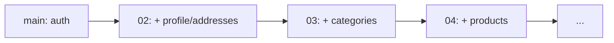
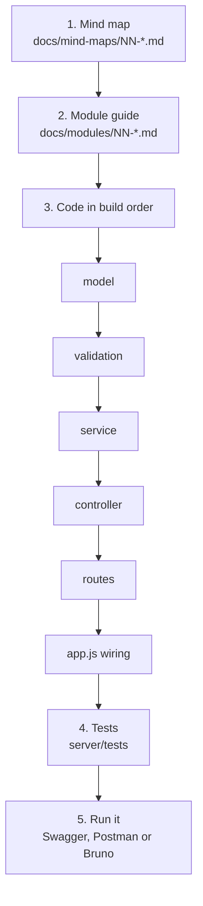

# Start here

This repo teaches you how a real web shop backend (and later its frontend) is built, **one module per branch**.

## The idea in one picture



Each branch = the previous branch + one new module. Nothing is ever removed. So:

- **To use** a step: check out its branch. It runs and passes its tests on its own.
- **To study** a step: compare it with the step before. The difference is exactly one module.

## How to study one branch

```bash
git branch -a                          # list all steps
git checkout 02-profile-addresses      # switch to a step
git diff main..02-profile-addresses --stat   # which files this step added/changed
git diff main..02-profile-addresses -- server/src   # the code changes only
git log --oneline main..02-profile-addresses        # the commits of this step, in build order
```

> On `main` (the first step) there is nothing to compare with. Read everything.

## Reading order for each module



1. **Mind map**: how to *think* about the module before writing code.
2. **Module guide**: endpoints, data model and flows (with diagrams).
3. **Code, in build order**. This is the order a developer writes it:
   - **model**: what data we store
   - **validation**: what input we accept
   - **service**: the business rules
   - **controller**: HTTP in, HTTP out
   - **routes**: URLs and guards
   - **`app.js`**: plugging the module in
4. **Tests**: read them as a *specification*. Each `it('...')` is a promise the code keeps.
5. **Run it**: start the server, open `/api/docs`, or run the Postman/Bruno collection.

Then read any **concept** doc that is new to you (links in the root [README](../README.md)).

## Tips

- Run `npm test` before and after changing anything. Green before, green after.
- Break things on purpose. Delete a check in a service and watch which test fails, and why.
- Each `docs/modules/*.md` ends with **exercises**. Do them on a scratch branch (`git checkout -b my-practice`).

## Words you don't know?

See the [glossary](concepts/glossary.md).

## Learn testing properly

New to testing? Read the **[Testing handbook](testing-handbook/README.md)**: what unit, integration and API
tests are, how every tool in this repo is set up, how to add the same setup to your own projects, and a
practice roadmap to grow your backend engineering skills.
