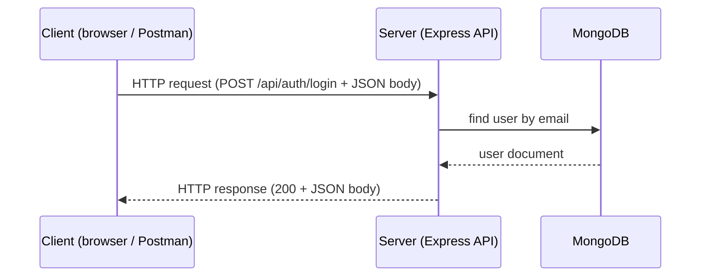

# 01 – How the web works

## Client and server

A **client** asks. A **server** answers.

- The **client** is the browser (later our React app), Postman, Bruno, or a test.
- The **server** is our Express API. It listens on a **port** (5000) for requests.



They talk with **HTTP** (HyperText Transfer Protocol), a simple text format for messages.

## An HTTP request

```
POST /api/auth/login HTTP/1.1          ← method + path
Host: localhost:5000
Content-Type: application/json         ← headers: extra info about the message
Authorization: Bearer eyJhbGciOi...    ← (only for protected routes)

{"email":"ali@example.com","password":"secret123"}   ← body (JSON)
```

## An HTTP response

```
HTTP/1.1 200 OK                         ← status code
Content-Type: application/json

{"success":true,"message":"Login successful","data":{"token":"...","user":{...}}}
```

## HTTP methods (verbs)

| Method | Meaning | Example in this repo |
|---|---|---|
| `GET` | Read something (no body, no changes) | `GET /api/auth/me` |
| `POST` | Create something or run an action | `POST /api/auth/register` |
| `PUT` | Replace / update something | `PUT /api/users/password` |
| `PATCH` | Change part of something | (later: `PATCH /api/addresses/:id/default`) |
| `DELETE` | Remove something | (later: `DELETE /api/addresses/:id`) |

## Status codes

The first digit tells you the group: **2xx** = OK, **4xx** = the *client* made a mistake, **5xx** = the *server* has a bug.

| Code | Name | When we use it |
|---|---|---|
| 200 | OK | Normal success |
| 201 | Created | Register created a new user |
| 400 | Bad Request | Validation failed, bad JSON, invalid/expired email link |
| 401 | Unauthorized | Not logged in, bad token, wrong password |
| 403 | Forbidden | Logged in but not allowed (wrong role, disabled account) |
| 404 | Not Found | No route matches the URL |
| 409 | Conflict | Email already registered |
| 429 | Too Many Requests | Rate limit reached |
| 500 | Internal Server Error | A bug or a missing setting on our side |

> 401 vs 403: **401** = "I don't know who you are." **403** = "I know who you are, and the answer is no."

## JSON

**JSON** (JavaScript Object Notation) is the text format our API reads and writes:

```json
{ "name": "Ali", "age": 30, "tags": ["new"], "verified": false }
```

`express.json()` in `app.js` turns the JSON body text into `req.body` (a JavaScript object). `res.json(...)` turns an object back into JSON text.

## REST

**REST** is a style for designing URLs:
- URLs name **things** (resources), as nouns: `/api/users`, `/api/products/123`
- The **method** says what to do with the thing: `GET` = read, `DELETE` = remove
- Each request carries everything the server needs. The server keeps no "conversation memory" between requests. This is called being **stateless**.

Auth routes are a known exception. They are **actions**, so they read like verbs: `/auth/login`, `/auth/verify-email`. That is normal and fine.

> **Try it**
> Start the server (`npm run dev`) and run:
> `curl -i http://localhost:5000/api/health` → see the status line, headers and JSON body.
> `curl -i http://localhost:5000/api/nope` → a 404 in the same JSON shape.

## Check yourself
1. What is the difference between a 401 and a 403?
2. Which part of a request carries the login token?
3. Why does `GET` never have a body in our API?
4. What does "stateless" mean for a REST server?

## In this repo
- `server/src/app.js`: JSON parsing, routes, health check
- `server/src/middleware/notFound.middleware.js`: the 404
- `server/src/modules/auth/auth.routes.js`: methods and paths
