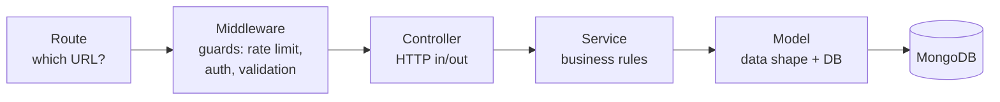
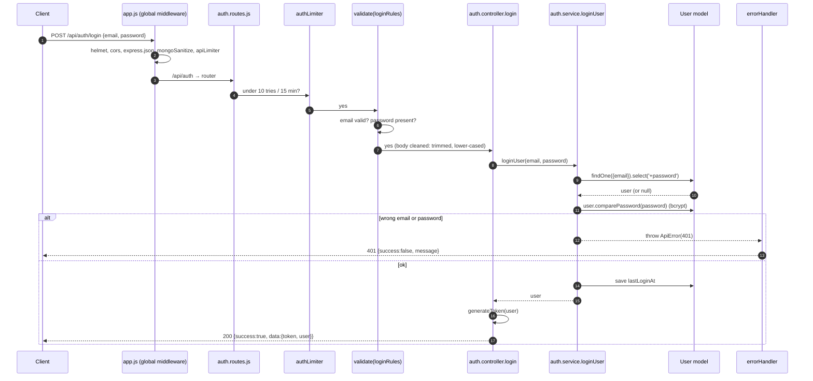

# 02 – Layered architecture

## The idea

We split the code into **layers**. Each layer has one job and only talks to the layer next to it. This is called **separation of concerns**.

| Layer | Job | Knows about HTTP? | Example file |
|---|---|---|---|
| **Route** | Maps a method + URL to a chain of functions | yes | `modules/auth/auth.routes.js` |
| **Middleware** | Checks and stops bad requests early | yes | `middleware/auth.middleware.js` |
| **Controller** | Reads `req`, calls one service, sends the response | yes | `modules/auth/auth.controller.js` |
| **Service** | The real logic: rules, database calls, emails | **no** | `modules/auth/auth.service.js` |
| **Model** | Data shape, rules on fields, helper methods | no | `modules/users/user.model.js` |

## Why bother?

- **Easy to find things.** A rule bug lives in a service. A missing guard lives in routes.
- **Easy to test.** Services don't need `req`/`res`, so you can call them from a test or a script.
- **Easy to change.** Swap Express for another framework and only routes/controllers change.
- **Same pattern everywhere.** Every module in this repo has the same files. Learn one, read them all.

## The real flow: `POST /api/auth/login`

Notice:
- The **controller** is 2 lines. It doesn't decide anything.
- The **service** decides everything, and simply `throw`s when something is wrong.
- The **error handler** turns any thrown error into the same JSON shape.

## Rules of thumb

- Controllers never talk to models directly. Go through a service.
- Services never touch `req` or `res`.
- Who is acting (`req.user._id`) comes from `protect`, **never** from the request body.

> **Try it**
> Open `auth.controller.js` and `auth.service.js` side by side. For each controller function, find the one service function it calls.

## Check yourself
1. Which layer should check "an admin cannot log in with Google"? Why?
2. Why must a service not use `res.status(...)`?
3. What is the order of middleware on `POST /api/auth/login`?
4. Where does the response JSON shape get decided for errors? For success?

## In this repo
- `server/src/app.js`: global middleware order
- `server/src/modules/auth/`: routes → controller → service
- `server/src/modules/README.md`: the module anatomy pattern
