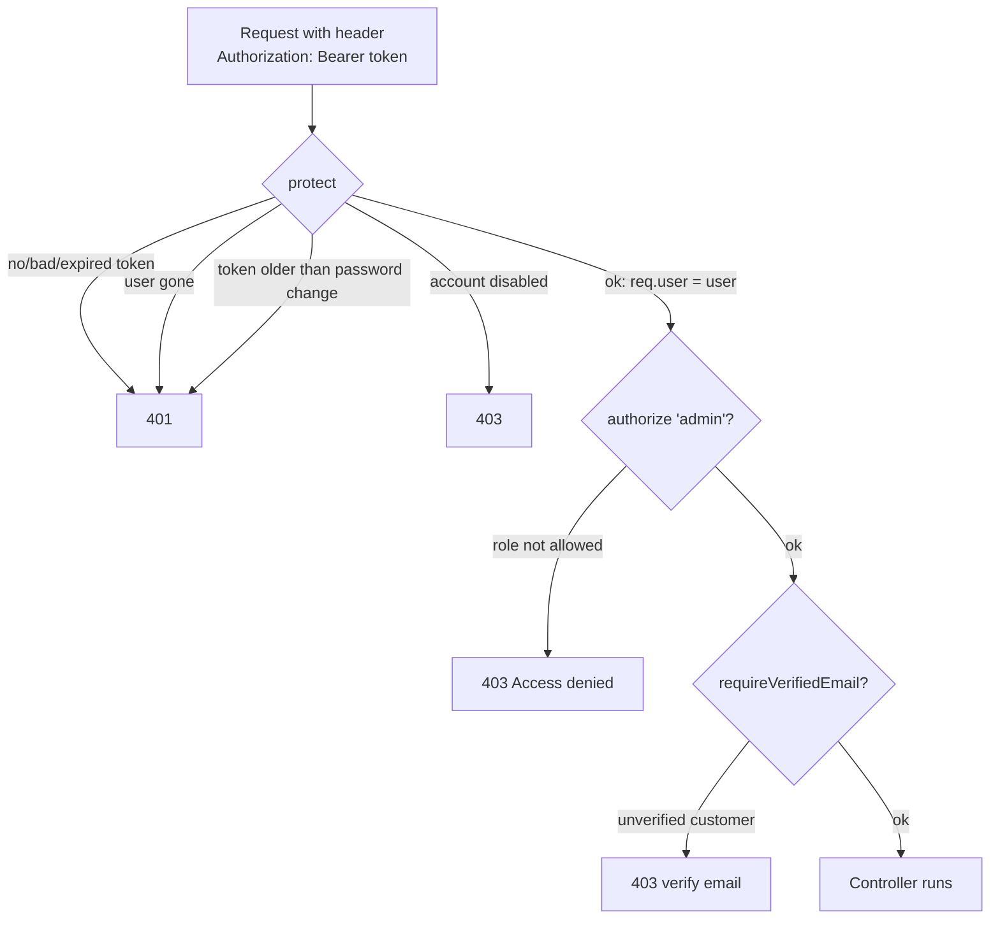

# 03 – Authentication vs authorization

Two different questions:

| | Authentication (AuthN) | Authorization (AuthZ) |
|---|---|---|
| Question | **Who are you?** | **Are you allowed to do this?** |
| Proof | Email + password, Google, a token | Your role, ownership, verified email… |
| Fails with | **401** Unauthorized | **403** Forbidden |
| In this repo | `protect` | `authorize(...roles)`, `requireVerifiedEmail` |

Real life: at an airport, the **passport check** is authentication. The **boarding pass for this gate** is authorization.

## How it flows here



## Logging in = getting a token

1. You **authenticate once**: `POST /api/auth/login` with email + password.
2. The server answers with a **token** (a JWT, see [05](05-jwt-and-sessions.md)).
3. On every later request you send `Authorization: Bearer <token>`.
4. `protect` checks the token and loads your user. That is authentication for **this** request.

## Roles

We have two **roles**: `customer` and `admin` (`config/constants.js`). This model is called **RBAC** (Role-Based Access Control).

```js
router.get('/admin/stuff', protect, authorize('admin'), handler);
```

- Registration **always** creates customers. Sending `"role": "admin"` is ignored.
- The first admin is created by a script (`npm run seed:admin`).
- Admins must use email + password (Google login refuses admins), and they have their own stricter login route `/auth/admin/login` (5 tries / 15 min).

## Other kinds of authorization (coming in later branches)

- **Ownership**: "you can only edit *your own* address" (branch 02). See [14 – Ownership and IDOR](14-authorization-ownership.md).
- **State rules**: "you can review a product only after it was delivered" (branch 09).

Authorization is not only about roles. It is any "are you allowed?" rule.

> **Try it**
> 1. Log in as a customer, then call `POST /api/auth/admin/login` with the same credentials → **403 Admin access only**.
> 2. Call `GET /api/auth/me` without a token → **401**.

## Check yourself
1. A customer calls an admin route with a valid token. 401 or 403?
2. Why does `protect` load the user from the database instead of trusting the token?
3. Why can't a user become admin by registering with `"role":"admin"`?
4. Where must `authorize('admin')` go relative to `protect`, and why?

## In this repo
- `server/src/middleware/auth.middleware.js`: `protect`, `authorize`, `requireVerifiedEmail`
- `server/src/db/scripts/seedAdmin.js`: creating the first admin
- `server/tests/unit/middleware.test.js`, `server/tests/integration/auth.test.js`
