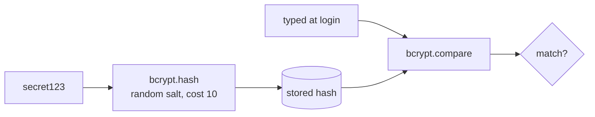

# 04 – Passwords and hashing

## Never store passwords

If our database leaks, attackers must **not** get anyone's password, because people reuse passwords on other sites.

So we store a **hash** of the password, never the password itself.

## Hashing vs encryption

| | Hashing | Encryption |
|---|---|---|
| Direction | **One way.** You cannot get the input back | Two way: decrypt with the key |
| Use | Checking a password | Hiding data you need to read later |
| For passwords? | ✅ yes | ❌ no. Whoever has the key can read every password |

To check a login, we hash what the user typed and compare it with the stored hash. We never need the real password back.

## bcrypt

A good password hash must be **slow**, so an attacker can't try billions of guesses per second. We use **bcrypt**:

```
$2b$10$N9qo8uLOickgx2ZMRZoMye.IjZAgcfl7p92ldGxad68LJZdL17lhW
 │  │  └── salt (22 chars) + hash (31 chars)
 │  └── cost: 10 → 2^10 rounds
 └── algorithm version
```

- **Salt**: random extra data added before hashing. Two users with the password `secret123` get **different** hashes. That defeats "rainbow tables", which are pre-computed lists of hashes.
- **Cost (salt rounds)**: each +1 doubles the time. We use **10** (`SALT_ROUNDS` in `user.model.js`). That is fast enough for login and slow for an attacker.



### Where it happens in our code
- `userSchema.pre('save')` hashes the password **only if it changed** (`isModified('password')`). Hashing a hash again would lock the user out.
- `user.comparePassword(plain)` uses `bcrypt.compare`.
- `password` has `select: false`, so normal queries don't even load the hash. Login asks for it with `.select('+password')`.
- The `toJSON` plugin deletes `password` from every response anyway (defence in depth).

## Random tokens: SHA-256 instead of bcrypt

Email-verification and reset links contain a **random token** (32 random bytes = 64 hex characters).

- We **email the plain token**.
- We **store only its SHA-256 hash** (`emailVerifyTokenHash`, `passwordResetTokenHash`).
- When the link is clicked, we hash the received token and look for a matching hash.

Why not bcrypt here? bcrypt is slow on purpose because humans pick **weak** passwords. A 32-byte random token is impossible to guess anyway, so a fast hash is enough. A fast hash also lets us **search** by it, while bcrypt's random salt makes searching impossible.

Why hash it at all? If the database leaks, attackers can't use the stored values to reset anyone's password.

Extra safety:
- Tokens **expire**: 24 hours for verify, 30 minutes for reset.
- Tokens are **single-use**: deleted after success.

## Password policy

`auth.validation.js → passwordRule`: 8–64 characters, at least one letter and one number. bcrypt only uses the first 72 bytes, which is why 64 is the maximum.

> **Try it**
> In a terminal inside `server/`:
> `node -e "import('bcrypt').then(async b=>{const h=await b.default.hash('secret123',10);console.log(h);console.log(await b.default.compare('secret123',h))})"`
> Run it twice: different hashes, both match.

## Check yourself
1. Why is a hash safer than encryption for passwords?
2. What does the salt protect against?
3. Why do reset tokens use SHA-256 but passwords use bcrypt?
4. Why does the pre-save hook check `isModified('password')`?
5. What two things make a reset link safe even if an email is forwarded later?

## In this repo
- `server/src/modules/users/user.model.js`: hashing hook, `comparePassword`, token helpers
- `server/src/db/plugins/toJSON.js`: hiding secrets
- `server/tests/unit/user.model.test.js`, `server/tests/integration/auth.test.js` ("stores the password hashed")
