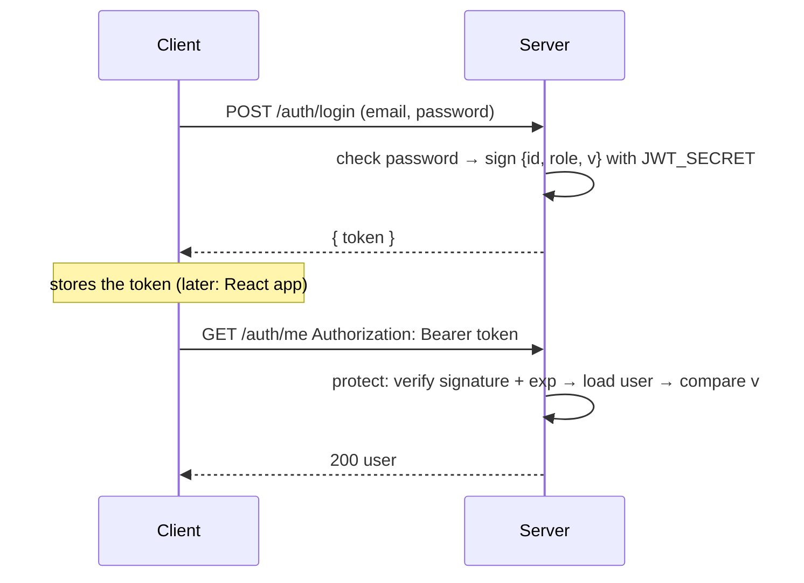

# 05 – JWT and sessions

## The problem

HTTP is **stateless**: each request is separate. After you log in, how does the server know the **next** request is you?

Two common answers:

| | Server sessions | Tokens (JWT), **our choice** |
|---|---|---|
| Server stores | A session record per logged-in user | Nothing per login |
| Client sends | A session id cookie | `Authorization: Bearer <token>` |
| Scaling to many servers | Needs a shared session store | Any server can check the signature |
| Logging out | Delete the session | Client deletes the token (see below) |

## What a JWT looks like

```
eyJhbGciOiJIUzI1NiIsInR5cCI6IkpXVCJ9 . eyJpZCI6IjY2NWYi…LCJyb2xlIjoiY3VzdG9tZXIiLCJ2IjowLCJpYXQiOjE3MDAwMDAwMDAsImV4cCI6MTcwMDA4NjQwMH0 . 3kQh…signature
           header                                         payload                                                                   signature
```

The three parts are base64url-encoded text joined by dots. Decoded, our **payload** is:

```json
{ "id": "665f1c2e9b1e8a0012345678", "role": "customer", "v": 0, "iat": 1700000000, "exp": 1700086400 }
```

| Field | Meaning |
|---|---|
| `id` | the user's MongoDB `_id` |
| `role` | `customer` or `admin` |
| `v` | the user's **token version** (see below) |
| `iat` | "issued at", in **seconds** since 1970 |
| `exp` | expiry time (we use `JWT_EXPIRES_IN=1d`) |

### Signed, not encrypted
- Anyone can **read** the payload (paste a token into jwt.io). So we never put an email, name or password in it.
- Nobody can **change** it without our `JWT_SECRET`: the signature would no longer match, and `jwt.verify` throws. A user who edits `"role":"customer"` → `"admin"` gets a 401.



## Why `protect` still loads the user

The token says who you **were** when it was created. Since then the account may have been **deleted** or **disabled**, or the password may have been **changed**. So `protect` always loads the user fresh and checks these.

## Logging out a stateless token

The server keeps no session, so "logout" means **the client deletes its token** (`POST /auth/logout` simply answers 200). The token itself stays valid until `exp`. That's why we keep expiry short (1 day).

Stricter apps add a **blocklist** of revoked token ids (in Redis), or short-lived access tokens plus refresh tokens. That's a later topic.

## Revoking every token at once: `tokenVersion`

When you change or reset your password, every old session (maybe a stolen one) should stop working.

How we do it:
1. The user document has `tokenVersion` (starts at `0`).
2. Each JWT stores the version at creation time: `v`.
3. Changing/resetting the password runs the pre-save hook, which does `tokenVersion += 1`.
4. `protect` rejects any token whose `v` ≠ the user's current `tokenVersion` → **401 "Password was changed, please log in again"**.
5. The change-password response returns a **fresh token** (with the new `v`), so the current device stays logged in.

### The bug story (a real lesson)

The original code used **timestamps** instead of a counter:
- On a password change it saved `passwordChangedAt = now − 1 second`.
- `protect` rejected tokens where `passwordChangedAt > iat × 1000`.

But `iat` is stored in **whole seconds** (rounded down). Example:

| Event | Real time | Value used in the check |
|---|---|---|
| Old token created | 12:00:00.900 | `iat` = 12:00:00 (the .900 is lost) |
| Password changed | 12:00:00.950 | `passwordChangedAt` = 11:59:59.950 (minus 1 s) |
| Check: `11:59:59.950 > 12:00:00.000`? | | **false** → the old token is **accepted** ❌ |

The token was created *before* the password change, yet it **kept working**.

So any token created less than about a second before a password change survived it. Our integration test "logs out old sessions" creates a token and changes the password right away, which hit exactly this case and failed. A **counter** has no clock precision problem, so we switched to `tokenVersion`.

**Lessons:**
1. Be careful comparing times with different precision (seconds vs milliseconds).
2. Tests that run fast find timing bugs that humans clicking slowly never see.

## Where to store the token (frontend, later)

You can keep it in memory/localStorage (simple, but readable by injected scripts) or in an httpOnly cookie (scripts can't read it, but you need CSRF protection). We'll discuss this in branch 11.

> **Try it**
> 1. Log in via Swagger (`/api/docs`) and copy the token. Paste it at https://jwt.io and read the payload.
> 2. Change one letter in the payload part and call `/api/auth/me` with it → 401.
> 3. Log in on "two devices" (two tokens), change the password with one → the other gets 401.

## Check yourself
1. Why must a JWT never contain a password or email?
2. What stops a user from editing their role inside the token?
3. Why does "logout" not invalidate a JWT on the server?
4. Explain in your own words why the timestamp approach had a gap and the counter doesn't.
5. Why does change-password return a new token?

## In this repo
- `server/src/utils/generateToken.js`: signing (`id`, `role`, `v`)
- `server/src/middleware/auth.middleware.js`: `protect`
- `server/src/modules/users/user.model.js`: `tokenVersion`, `isTokenOutdated`
- `server/tests/integration/users.test.js`, `auth.test.js` (forged/expired tokens, "logs out old sessions")
