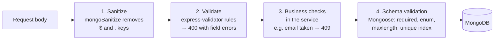

# 06 – Validation and trust

## Rule #1: never trust the client

Anything that arrives in a request can be **anything**: wrong types, missing fields, huge strings, extra fields, attack payloads. Postman, curl or a script can send whatever they like. Your React form's checks don't protect the server.

So the server checks **every** input itself.

## Three lines of defence



1. **Sanitize** (`app.js`): `express-mongo-sanitize` deletes keys like `$ne` (see [08](08-security-basics.md)).
2. **Validate at the edge** (`*.validation.js` + `validate` middleware): types, formats, lengths. It also **cleans** values (`trim`, `toLowerCase`), so the controller receives tidy data.
3. **Business rules** (service): things only the database can answer, like "is this email already registered?"
4. **Schema validation** (model): the last safety net. Even a buggy service can't save a user without a name or with `role: 'superuser'`.

Why validate twice (edge + schema)? Edge validation gives **nice per-field messages** to the user. Schema validation **guarantees data quality** no matter which code path saves data (services, scripts, future code).

## The error shape

```json
{
  "success": false,
  "message": "Validation failed",
  "errors": [
    { "field": "email", "message": "Email is invalid" },
    { "field": "password", "message": "Password must be 8–64 characters" }
  ]
}
```

The frontend can put each message under the right input field.

## express-validator in 30 seconds

```js
body('email')            // look at req.body.email
  .isString().withMessage('Email is required')   // check + message for that check
  .bail()                // stop here if it failed (don't also say "invalid")
  .trim().toLowerCase()  // sanitizers: change the value
  .isEmail().withMessage('Email is invalid');
```

`validate(rules)` runs all rules and turns failures into `ApiError(400, 'Validation failed', errors)`, keeping only the **first** error per field.

## Mass assignment

**Mass assignment** = blindly saving whatever fields the client sent:

```js
// ❌ DANGEROUS
await User.create(req.body);   // client sends {"role":"admin","isEmailVerified":true}
```

Our service **picks** fields and **forces** the rest:

```js
// ✅ SAFE (auth.service.js)
createUser({ name, email, password, role: 'customer' });
```

There is a test proving it: "ignores role/isEmailVerified sent by the client".

## Identity comes from the token

"Who is doing this?" is always `req.user._id` (set by `protect`), **never** a `userId` in the body or URL. Otherwise anyone could act as anyone.

## Login is special

Login only checks that a password is **present**, not the policy (length, letters, digits). Why?
- Checking the policy at login tells attackers what the policy is.
- Accounts made before a policy change must still be able to log in.

> **Try it**
> `POST /api/auth/register` with `{"name":"A","email":"x","password":"123"}` and read the `errors` array.
> Then send `{"name":"Ali","email":"a@b.co","password":"secret123","role":"admin"}` and check `data.user.role`.

## Check yourself
1. Why isn't frontend validation enough?
2. Why do we validate in the request AND in the schema?
3. What is mass assignment and how does `registerUser` avoid it?
4. Why does login skip the password-policy checks?

## In this repo
- `server/src/middleware/validate.middleware.js`
- `server/src/modules/auth/auth.validation.js`, `server/src/modules/users/user.validation.js`
- `server/src/modules/users/user.model.js`: schema rules
- `server/tests/integration/auth.test.js`: the `it.each` validation table
