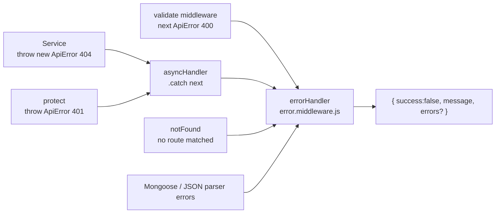

# 07 – Error handling

## Goal

1. Every error reaches the client in **one predictable shape**.
2. Developers write `throw`, not response-building code.
3. Users never see stack traces or internals in production.

## The pieces



### 1. `ApiError`, an error with a status
```js
throw new ApiError(409, 'Email already registered', [{ field: 'email', message: '...' }]);
```
It extends the built-in `Error` and adds `statusCode` and `errors`.

### 2. `asyncHandler`, catching async errors
In Express 4, if an `async` handler throws, Express doesn't notice, and the request **hangs forever**. `asyncHandler(fn)` runs `fn` and sends any rejection to `next(err)`.

### 3. `errorHandler`, the only place that sends errors
Express knows it's an error handler because it has **4 parameters** `(err, req, res, next)`. It is registered **last** in `app.js`.

It also translates library errors:

| Incoming error | Becomes |
|---|---|
| `ApiError` | its own status + message + errors |
| Mongoose `ValidationError` | 400 "Validation failed" + one entry per field |
| Mongoose `CastError` (bad ObjectId) | 400 "Invalid _id" |
| MongoDB duplicate key (`code 11000`) | 409 "email already exists" |
| Broken JSON body | 400 "Invalid JSON body" |
| Anything else | 500 |

For **5xx** errors (our bugs):
- The error is logged with `console.error` (not in tests).
- In **production** the message becomes "Something went wrong" (no internals leak).
- Outside production the response includes `stack` to help you debug.

### 4. `notFound`
Registered after all routes. If nothing answered, it creates a 404 `ApiError`.

## Success has a shape too

`sendSuccess(res, status, message, data, meta?)` →

```json
{ "success": true, "message": "Login successful", "data": { ... }, "meta": { ... } }
```

So the frontend always checks `success` and reads `data`.

## Expected vs unexpected errors

- **Expected** (4xx): the client did something wrong. Clear message, no log noise.
- **Unexpected** (5xx): our bug. Log it, hide the details, fix it.

## Emails don't throw

`sendEmail` catches its own errors and only logs them. A broken mail server must not make registration fail. The user can press "resend verification".

> **Try it**
> `curl -i -X POST localhost:5000/api/auth/login -H "Content-Type: application/json" -d "{bad json"` → 400 "Invalid JSON body".

## Check yourself
1. Why does the error handler need four parameters?
2. What happens to an async error without `asyncHandler`?
3. Why hide 500 messages in production?
4. Which status does a duplicate unique key produce, and why that one?

## In this repo
- `server/src/utils/ApiError.js`, `asyncHandler.js`, `ApiResponse.js`
- `server/src/middleware/error.middleware.js`, `notFound.middleware.js`
- `server/tests/unit/middleware.test.js` (`errorHandler` tests)
