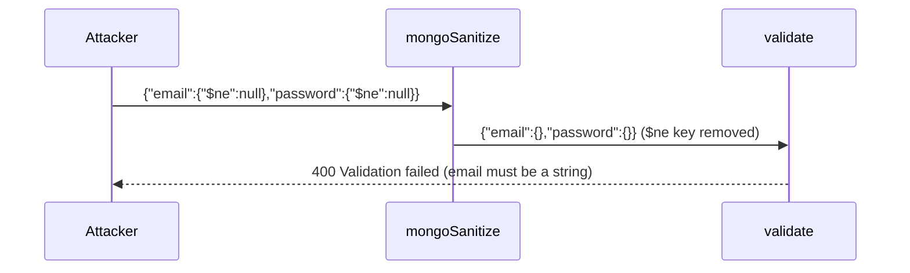
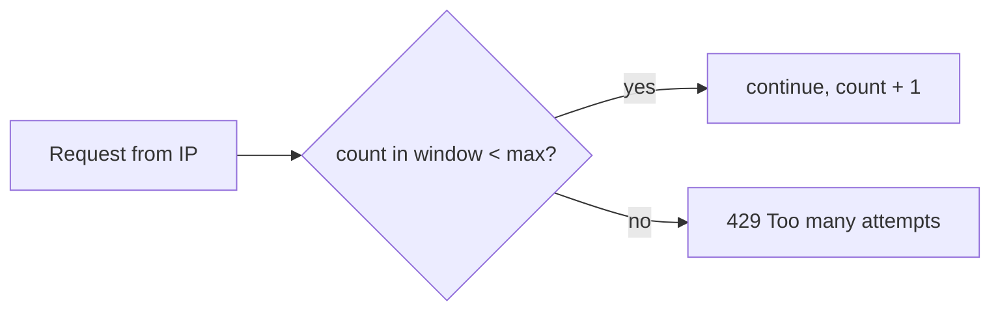

# 08 – Security basics

Security means thinking like an attacker: *"How could someone misuse this?"* The **OWASP Top 10** is the industry's list of the most common web-app risks. Here is what the code already defends against.

| Threat | What the attacker does | Our defence | Where |
|---|---|---|---|
| **NoSQL injection** | Sends `{"email":{"$ne":null}}` so the query means "any email" | `mongoSanitize` removes `$`/`.` keys, and validation requires strings | `app.js`, `auth.validation.js` |
| **Brute force** | Tries thousands of passwords | Rate limits: 10 auth tries / 15 min, 5 admin logins / 15 min | `rateLimit.middleware.js` |
| **Email flooding** | Spams "forgot password" | `emailLimiter`: 5 / hour | `auth.routes.js` |
| **User enumeration** | Learns which emails have accounts | Same 401 message for wrong email and wrong password; forgot-password always says the same | `auth.service.js`, `auth.controller.js` |
| **Password theft from a DB leak** | Reads the database | bcrypt hashes; reset/verify tokens stored as SHA-256 | `user.model.js` |
| **Token tampering** | Edits role in the JWT | Signature check with `JWT_SECRET` | `protect` |
| **Stolen session after password change** | Keeps using an old token | `tokenVersion` revocation | `user.model.js`, `protect` |
| **IDOR (someone else's data by id)** | Changes the address id in the URL to another customer's | Owner in every query → 404 ([14](14-authorization-ownership.md)) | `address.service.js` |
| **Privilege escalation** | Registers with `"role":"admin"` | Service forces `role: 'customer'` | `auth.service.js` |
| **Data leaks in responses** | Reads hashes from JSON | `select:false` + `toJSON` plugin | `user.model.js`, `toJSON.js` |
| **Cross-origin abuse** | Another website calls our API from a victim's browser | CORS allows only `CLIENT_URL` | `app.js` |
| **Clickjacking, MIME sniffing, …** | Browser tricks | `helmet` security headers | `app.js` |
| **HTML injection in emails** | Registers with name `<a href=evil>` | `escapeHtml` in templates | `emails/templates.js` |
| **Leaked secrets** | Finds keys in git | `.env` is git-ignored; only `.env.example` is committed | `.gitignore` |
| **Huge request bodies** | Sends a 1 GB body | `express.json({ limit: '100kb' })` | `app.js` |
| **Internal details in errors** | Reads stack traces | 5xx details hidden in production | `error.middleware.js` |

## NoSQL injection, step by step

Without the defences, `User.findOne({ email: { $ne: null } })` would return **the first user in the database**.

## Rate limiting

Counts live **in this server's memory**. With several servers you need a shared store such as Redis (see [13](13-system-design-baseline.md)). `app.set('trust proxy', 1)` makes the limiter see the real client IP behind a proxy like Vercel.

`RATE_LIMIT_ENABLED=false` turns the limits off. It exists only for tests and repeated Postman runs; never use it in production.

## CORS in one paragraph

Browsers block a page on site A from reading responses from site B, unless B says it's okay with the `Access-Control-Allow-Origin` header. We say okay only for our frontend (`CLIENT_URL`). Note: CORS protects **browsers** only. curl and Postman ignore it, which is why auth still matters.

## Secrets

- Secrets (`JWT_SECRET`, DB passwords, API keys) live in `.env`, never in code or git.
- `JWT_SECRET` must be long and random: `node -e "console.log(require('crypto').randomBytes(48).toString('hex'))"`.
- If a secret leaks, **rotate** it (change it). Changing `JWT_SECRET` logs everyone out.

> **Try it**
> Run the test "blocks NoSQL-injection attempts" (`npm test -- -t "NoSQL"`), then comment out `app.use(mongoSanitize())` and run it again. What changes? (Undo afterwards.)

## Check yourself
1. Why does the forgot-password route answer the same for unknown emails?
2. Why is `trust proxy` needed for rate limiting on Vercel?
3. Does CORS stop an attacker using curl? What does protect us then?
4. Name two places where secrets could leak, and how we prevent each.

## In this repo
- `server/src/app.js`: helmet, CORS, body limits, mongoSanitize
- `server/src/middleware/rateLimit.middleware.js`
- `server/tests/integration/app.test.js` (headers, CORS), `rateLimit.test.js`, `auth.test.js` (injection, enumeration)
