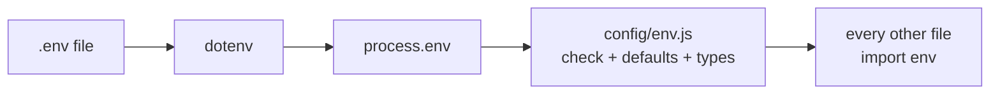

# 09 – Config and environments

## The same code, different settings

The same code runs in three places:

| Environment | `NODE_ENV` | Database | Email | Why |
|---|---|---|---|---|
| **development** | `development` | Atlas (your dev DB) | Mailpit (Docker) | You build and click around |
| **test** | `test` | in-memory MongoDB | in-memory outbox | Automated tests, fast and isolated |
| **production** | `production` | Atlas (live DB) | real SMTP provider | Real customers |

Settings that change between them live **outside the code**, in environment variables. This is rule III of the **12-Factor App** (a well-known checklist for cloud apps): *store config in the environment*.

## How we load config

`server/src/config/env.js` is the **only** file that reads `process.env`. It:
1. Loads `.env` with dotenv.
2. **Fails fast**: if `MONGO_URI` or `JWT_SECRET` is missing, it prints a clear message and exits. A crash at start-up beats a confusing error on the first request.
3. Applies **defaults** (`PORT=5000`, `JWT_EXPIRES_IN=1d`, …).
4. Converts **types**: env values are always strings, so `Number(process.env.PORT)` and `RATE_LIMIT_ENABLED !== 'false'`.
5. Adds handy flags: `env.isProduction`, `env.isTest`, `env.CLIENT_URLS` (array), `env.FRONTEND_URL`.

## `.env` vs `.env.example`

| File | Committed? | Contains |
|---|---|---|
| `.env.example` | ✅ yes | Every variable with **fake** values and comments: the documentation |
| `.env` | ❌ never (`.gitignore`) | Your **real** secrets |

New developer = copy `.env.example` to `.env` and fill it in.

## Behaviour switches by environment

| Code | dev | test | prod |
|---|---|---|---|
| morgan request logs | `dev` format | off | `combined` format |
| `sendEmail` | SMTP → Mailpit | outbox array | SMTP → provider |
| 5xx error message | real message + stack | real message | "Something went wrong" |
| Mongoose `autoIndex` | on | (tests sync indexes) | off → `npm run db:indexes` |

## How tests set config

`server/tests/setup/env.js` runs before every test file and sets fake values (`NODE_ENV=test`, a test `JWT_SECRET`, `RATE_LIMIT_ENABLED=false`, and a separate database per Jest worker).

> **Try it**
> Rename your `.env` temporarily and run `npm run dev` → the fail-fast message. Rename it back.

## Check yourself
1. Why is only `env.js` allowed to read `process.env`?
2. What does "fail fast" mean and why is it good?
3. Why does `RATE_LIMIT_ENABLED` compare with the string `'false'`?
4. Which file is the documentation of all settings?

## In this repo
- `server/src/config/env.js`, `server/.env.example`
- `server/tests/setup/env.js`
