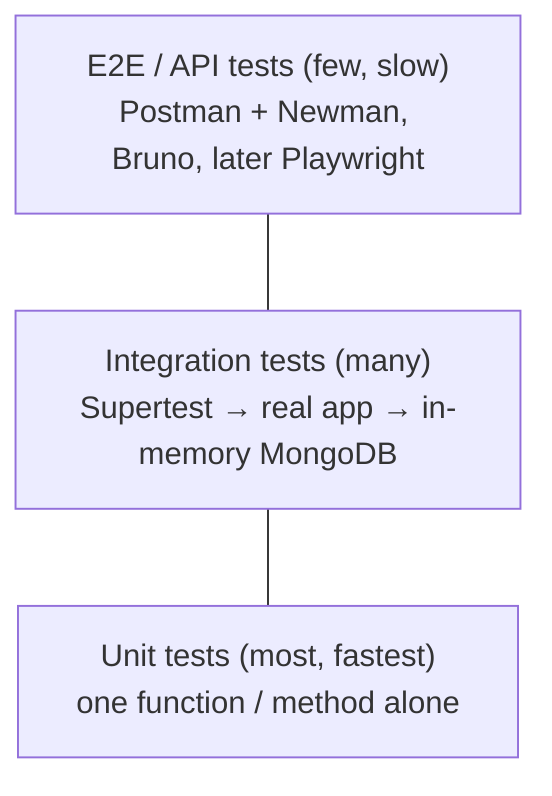

# 11 – Testing strategy

## Why automated tests?

- They prove the code does what we **promise**, every time, in seconds.
- They catch **regressions**: something that worked yesterday and broke today.
- They are living **documentation**: each `it('...')` is a sentence about behaviour.
- They find bugs humans miss. Our tests found the [tokenVersion bug](05-jwt-and-sessions.md#the-bug-story-a-real-lesson).

## The testing pyramid



| Level | Tests | Speed | Here |
|---|---|---|---|
| **Unit** | One small piece alone | ms | `tests/unit/`: model methods, middleware, utils |
| **Integration** | Many pieces together through real HTTP | ~10–100 ms | `tests/integration/`: every route |
| **E2E / API** | The running server + real services (Mailpit, DB) | seconds | Postman/Newman, Bruno |

More tests at the bottom (cheap, precise), fewer at the top (expensive, but closest to reality).

## What we test for each route

- ✅ the happy path
- ❌ 400 validation errors
- 🔒 401 missing / invalid / expired / forged token
- 🚫 403 wrong role, disabled account
- 🔍 404 not found, 409 conflicts, 429 rate limits
- 🛡 security: role from the body is ignored, NoSQL injection, enumeration-safe messages, old tokens after a password change

## Key techniques

**Isolation.** Every test must pass alone and in any order.
- Each Jest worker gets its own database (`shopease_test_<worker>`).
- `afterEach(clearTestDB)` deletes all documents and the email outbox after **each** test.

**Factories.** `createUser()`, `createAdmin()`, `loggedIn()`, `bearer(user)` keep tests short and focused on *what* they check.

**Test doubles.** A **stub** replaces a real dependency with a fake one. `google.test.js` replaces `googleVerifier.verify` so tests never call Google. In-memory MongoDB and the email outbox are **fakes** too: working, simplified replacements.

**Arrange – Act – Assert:**
```js
it('returns 409 when the email is already registered', async () => {
  const existing = await createUser();                         // Arrange
  const res = await api().post('/api/auth/register')           // Act
    .send({ name: 'Ali', email: existing.email, password: PASSWORD });
  expect(res.status).toBe(409);                                // Assert
});
```

**Table tests.** `it.each([...])` runs the same test for many inputs (see the validation table in `auth.test.js`).

## Quality gates

- **Coverage gate**: `jest.config.js` makes the run fail under 90% lines/statements/functions or 80% branches. Coverage shows which lines ran, not that they're correct, so it's a minimum, not a goal.
- **Pre-commit hook** (Husky): lint-staged + the full test suite before every commit.
- **CI** (GitHub Actions): lint + format check + tests on every push.
- **Regression rule** for this repo: a later branch may **add** tests but must keep every earlier test passing **unchanged**.

> **Try it**
> `npm run test:coverage`, then open `server/coverage/lcov-report/index.html` in a browser. Click a file to see red (never run) lines.

## Check yourself
1. Why do we have more unit tests than E2E tests?
2. What is a stub? Where do we use one?
3. What would break if we didn't clear the DB after each test?
4. Why isn't 100% coverage proof that code is correct?
5. What does the regression rule protect?

## In this repo
- `server/jest.config.js`, `server/tests/setup/*`, `server/tests/helpers/*`
- `server/tests/unit/*`, `server/tests/integration/*`
- `server/postman/`, `server/bruno/`
- Full how-to: [docs/testing/README.md](../testing/README.md)
