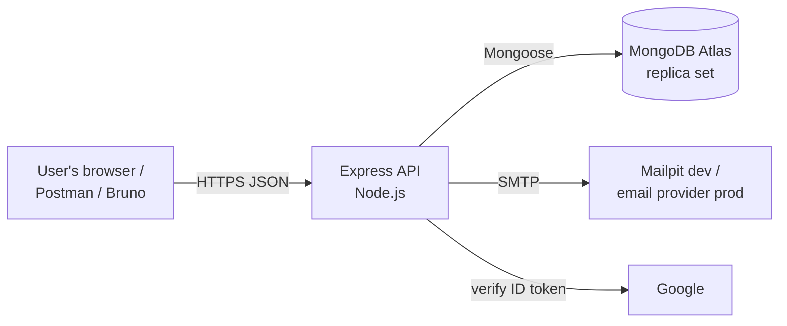
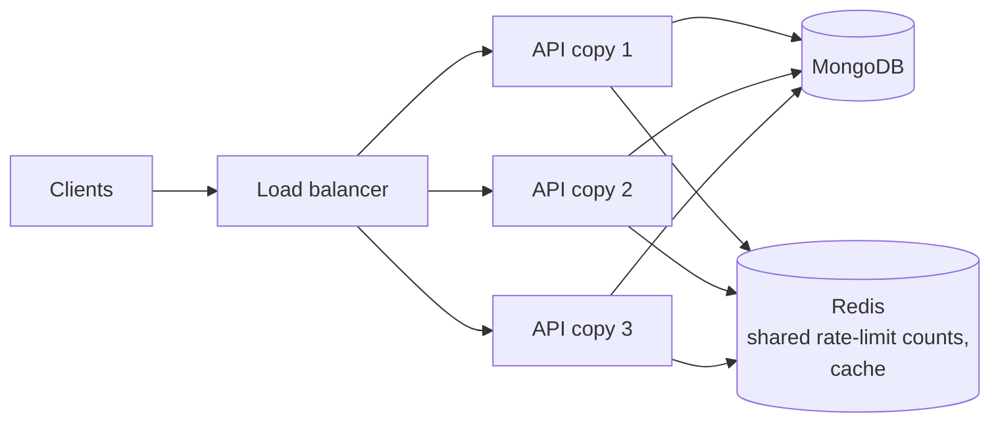

# 13 – System design baseline

**System design** = deciding the big pieces of a system and how they talk, so it stays fast, reliable and affordable as it grows. Here is the baseline vocabulary, mapped to our shop.

## Our system today (branch 01)

## 1. Client–server

Clients (browser, mobile app) handle display. The server holds the rules and the data. **Never put business rules only in the client.** The server must enforce them ([06](06-validation-and-trust.md)).

## 2. Stateless servers and horizontal scaling

Our API keeps **no user state in memory between requests**. The JWT carries "who you are", and the database holds everything else. That makes the API **stateless**.

Stateless servers can be **scaled horizontally**: run 2, 5 or 50 copies behind a **load balancer**, a component that spreads requests across them.

**Vertical scaling** = a bigger machine. It is simple, but it has a ceiling and is a single point of failure.

## 3. Where state lives

| State | Where | Why |
|---|---|---|
| Users, orders, … | MongoDB | durable, shared by all copies |
| "Who is logged in" | the JWT, on the client | no server session needed |
| Rate-limit counters | **memory today** → Redis when there are several copies | each copy counting alone would multiply the limit |
| Uploaded images (branch 04) | Cloudinary | servers' disks are temporary on cloud hosts |

Our in-memory rate limiter is a known simplification (see `rateLimit.middleware.js`).

## 4. Caching

A **cache** keeps a copy of data that is expensive to compute or fetch, for fast reuse (e.g. the category list in Redis or a CDN). Trade-off: cached data can be **stale**. Rule: cache read-heavy, rarely-changing data first.

## 5. Asynchronous work and queues

Sending an email takes time and can fail. Today `sendEmail` runs inside the request and swallows errors. At scale you would put a job on a **queue** (BullMQ, SQS, …) and let a **worker** send it, with retries. The user gets a fast response, and failures are retried.

## 6. Reliability

- **Replica sets**: database copies with automatic failover (Atlas does this).
- **Health checks**: `/api/health` lets platforms restart unhealthy instances.
- **Graceful shutdown**: `server.js` finishes in-flight requests on SIGINT/SIGTERM.
- **Transactions** keep related writes consistent (branch 07).

## 7. Observability

You can't fix what you can't see:
- **Logs**: morgan request logs, `console.error` for 5xx. Production apps use structured logs (JSON) collected centrally.
- **Metrics**: request rate, error rate, latency.
- **Tracing**: following one request across services.

## 8. CI/CD

- **CI** (Continuous Integration): every push runs lint + tests automatically (`.github/workflows/ci.yml`).
- **CD** (Continuous Delivery/Deployment): passing builds deploy automatically (e.g. Vercel on push).

## 9. Serverless vs long-running servers

| | Long-running (`server.js`) | Serverless (`api/index.js` on Vercel) |
|---|---|---|
| Process | runs all the time | started per request, may be frozen in between |
| Scaling | you add instances | platform scales automatically |
| Cost | pay for uptime | pay per request |
| Gotchas | you manage the server | cold starts, no long jobs, connection reuse matters (our `connectDB` cache) |

Our code supports **both**, because `app.js` never calls `listen()`.

## Check yourself
1. Why does a stateless API scale horizontally more easily?
2. What breaks about in-memory rate limiting with 3 server copies?
3. Give one example where a queue would improve our system.
4. Why does `api/index.js` need the connection cache in `db.js`?

## In this repo
- `server/src/app.js` vs `server/src/server.js` vs `server/api/index.js`
- `server/src/middleware/rateLimit.middleware.js` (memory store note)
- `.github/workflows/ci.yml`, `docker-compose.yml`
