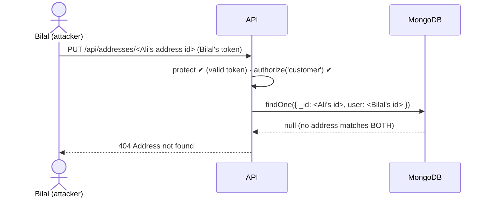

# 14 – Ownership: resource-level authorization (and IDOR)

[03](03-authentication-vs-authorization.md) introduced two questions: **who are you?** (authentication) and **are you allowed?** (authorization). Roles answer the second question only roughly. This doc covers the finer part: **is this particular thing yours?**

## Two levels of "allowed"

| Level | Question | Example | Where it's checked | Fails with |
|---|---|---|---|---|
| **Route level** (roles) | May *this kind of user* call this URL at all? | Only customers may use `/api/addresses` | `authorize('customer')` middleware | **403** |
| **Resource level** (ownership) | May *this user* touch *this record*? | Ali may edit address `665f…79`, but only if it is Ali's | the **service**, in the database query | **404** |

Route-level checks can live in middleware because they only need `req.user.role`. Ownership needs the record itself, and only the database knows who owns address `665f…79`. So that check belongs in the service, in the query.

## IDOR: the bug ownership prevents

**IDOR** = *Insecure Direct Object Reference*. It's part of OWASP's #1 risk, *Broken Access Control*.

The bug looks harmless:

```js
// ❌ VULNERABLE: finds the address by id only
const address = await Address.findById(req.params.id);
```

Ali is logged in. His address has id `...79`. He changes the URL to `...7a`, then `...7b`, and so on. Every request passes `protect` (he is logged in) and `authorize('customer')` (he is a customer). Each one returns **someone else's** name, phone number and home address. Nothing checked that the record belongs to him.

The fix is one extra condition, on **every** query:

```js
// ✅ SAFE: the id AND the owner must match
const address = await Address.findOne({ _id: req.params.id, user: req.user._id });
if (!address) throw new ApiError(404, 'Address not found');
```

The owner id comes from the **verified token** (`req.user._id`), never from the body or the URL. The client can change the URL and the body, but it can't forge the token.



## Why 404 and not 403?

A **403** means "this exists, but it's not yours". That already leaks something: an attacker can **probe** ids and learn which ones exist. A **404** gives exactly the same answer for "doesn't exist" and "not yours". From the caller's point of view, other people's data simply isn't there.

(It's the same idea as the identical login error in [08](08-security-basics.md): don't help attackers enumerate.)

## Where ownership shows up in this repo

| Rule | How | File |
|---|---|---|
| List shows only my addresses | `find({ user: userId })` | `address.service.js` |
| Update / delete / set default only my address | `{ _id: id, user: userId }` in every filter | `address.service.js` |
| Set-default can't half-happen on someone else's id | the ownership check runs **inside** the transaction, and a miss rolls everything back | `address.service.js` → `makeDefault` |
| The owner can't be faked on create | `user` is set from the token; `user` in the body is ignored | `address.service.js` → `pick` |
| Profile is always *mine* | no `:id` in `/api/users/profile`; the user comes from the token | `user.routes.js` |

Later branches reuse the same pattern: my cart, my wishlist, my orders, my reviews.

## A checklist for every route that takes an id

1. Is the id well-formed? → `validateObjectId('id')` → **400** (stops junk before the DB).
2. Who may call the route at all? → `protect` + `authorize(...)` → **401 / 403**.
3. Does the query include the owner? → `{ _id, user: req.user._id }` → **404** if not found.
4. Can the body change the owner (`user`, `userId`, `owner`)? It must not: copy only the allowed fields.
5. Is there a test where **customer B** uses **customer A's** id? There must be, for every verb.

## Admins are a separate path

Admins usually *should* see other people's data (support, refunds). Don't weaken the customer routes for that. Give admins their **own** routes, guarded by `authorize('admin')` (branch 10). The customer routes stay strict, and the admin routes are easy to audit.

> **Try it**
> 1. Start the API, log in as two customers in Postman (folder **02 Profile & Addresses** does it for you).
> 2. Run "Ownership – update someone else's address → 404".
> 3. In `address.service.js`, change `updateAddress` to `Address.findById(id)` and run `npm test -- tests/integration/addresses.test.js`. Which tests fail, and what do they prove? (Undo afterwards!)

## Check yourself
1. Customer B calls `DELETE /api/addresses/<A's id>`. What status, and why not 403?
2. Why can't `authorize()` check ownership?
3. Where does the owner id come from, and why never from the request body?
4. What is IDOR, and which OWASP category is it in?

## In this repo
- `server/src/modules/addresses/address.service.js`
- `server/src/modules/addresses/address.routes.js`
- `server/tests/integration/addresses.test.js` (look for "no IDOR")
