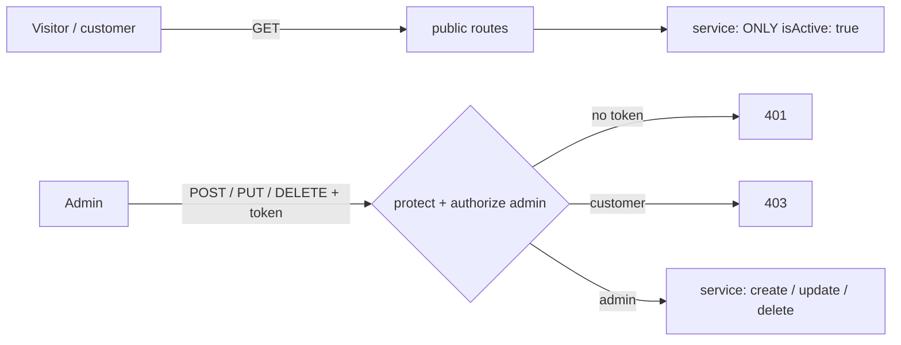

# 15 – Slugs, and public vs admin APIs

Branch 03 (categories) brings two new ideas. Neither is hard, but both show up in almost every real web shop:

1. **Slugs**: readable names in URLs instead of database ids.
2. **Public vs admin APIs**: the same data, read by anyone, but changed only by admins.

## 1. Slugs

A **slug** is the human-friendly part of a URL:

```
/api/categories/665f1c2e9b1e8a0012345680     ← id: means nothing to a person
/api/categories/mens-shoes                   ← slug: readable, shareable, good for SEO
```

The slug is made from the name by `slugify()` (`server/src/db/utils/slugify.js`):

| Name                 | Slug           | What happened                                   |
| -------------------- | -------------- | ----------------------------------------------- |
| `Electronics`        | `electronics`  | lower-cased                                     |
| `Men's Shoes`        | `mens-shoes`   | apostrophe removed, space → dash                |
| `  Home & Kitchen  ` | `home-kitchen` | trimmed, `&` removed, runs of spaces → one dash |
| `Café Crème`         | `cafe-creme`   | accents removed (`normalize('NFKD')`)           |
| `کپڑے` (Urdu)        | `item`         | nothing URL-friendly left → fallback word       |

A slug must match `REGEX.SLUG` = `^[a-z0-9]+(?:-[a-z0-9]+)*$`: groups of lowercase letters/digits joined by single dashes.

### Slugs must be unique

`GET /api/categories/mens-shoes` must find **one** category. But two _different_ names can give the _same_ slug: `Men's Wear` and `Mens Wear` both become `mens-wear`. `uniqueSlug()` asks the database and adds a number:

```
"Men's Wear" → mens-wear
"Mens Wear"  → mens-wear taken → mens-wear-2
"Mens-Wear!" → mens-wear, mens-wear-2 taken → mens-wear-3
```

The **unique index** on `slug` is the safety net. If two admins save at exactly the same moment, both could pick `mens-wear-2`. The second save then fails with MongoDB error `11000`, and the error handler turns that into **409**. This is the same "check in code, guarantee in the database" pattern as the one-default-address index in branch 02.

### Who sets the slug?

**Never the client.** The model's `pre('validate')` hook builds it from the name every time a category is created or renamed. A `slug` in the request body is ignored (mass assignment protection, see [14](14-authorization-ownership.md)).

### Slug or id?

| Use the… | When                                           | Why                                             |
| -------- | ---------------------------------------------- | ----------------------------------------------- |
| **slug** | reading public pages (`GET /categories/:slug`) | readable, shareable links                       |
| **id**   | changing data (`PUT/DELETE /categories/:id`)   | a rename changes the slug, the id never changes |

Renaming "Shoes" to "Footwear" changes the slug to `footwear`, and the old link `/categories/shoes` returns 404. Big shops keep a list of old slugs and send a _redirect_ (HTTP 301) instead. That's exercise 3 in the [module guide](../modules/03-categories.md#exercises).

## 2. Public vs admin APIs

Categories are the first module where **visitors who are not logged in** call the API. One router holds both kinds of routes:

```js
const adminOnly = [protect, authorize(ROLES.ADMIN)];

router.get("/", c.list); // public: no guard at all
router.get("/:slug", c.getBySlug); // public
router.post("/", ...adminOnly, validate(createCategoryRules), c.create);
router.put(
  "/:id",
  ...adminOnly,
  validateObjectId("id"),
  validate(updateCategoryRules),
  c.update,
);
router.delete("/:id", ...adminOnly, validateObjectId("id"), c.remove);
```



### What the public sees is a filtered view

Admins can switch a category **off** (`isActive: false`) instead of deleting it. For the public, an inactive category does not exist:

- `GET /categories` lists only `isActive: true`;
- `GET /categories/:slug` of an inactive category returns **404**, exactly like a missing one.

This is the same idea as "not yours → 404" in [14](14-authorization-ownership.md). The public API never says "this exists, but it's hidden".

### Why "deactivate" instead of "delete"?

From branch 04, products point to a category. Deleting a category that products still use would leave them pointing at nothing. So the service will **refuse** that delete (a `// Branch 04:` note marks the spot in `category.service.js`), and the admin deactivates it instead. Right now it already refuses to delete a category that has **sub-categories**, for the same reason.

### A tree with a fixed depth

A category can have a `parent`, so categories form a tree. This shop allows **two levels** only (`Men → Shoes`). Three service rules keep it that way:

1. the parent must be top-level (no `Men → Shoes → Sneakers`);
2. a category that has children can't become a child;
3. nothing can be its own parent.

They live in the service (not in the model) so a broken rule is a clear **400** with a message, not a 500.

## Check yourself

1. Why can't the slug be the only thing that identifies a category in `PUT` and `DELETE`?
2. `Men's Wear` exists. An admin creates `Mens Wear`. What is the new slug? Is it a 409?
3. Why does an inactive category return 404 and not 403 on the public route?
4. Where is the slug's uniqueness _guaranteed_: in `uniqueSlug()` or in MongoDB? Why both?

## In this repo

- `server/src/db/utils/slugify.js` and `server/tests/unit/slugify.test.js`
- `server/src/modules/categories/category.model.js` (slug hook, indexes)
- `server/src/modules/categories/category.routes.js` (public + admin routes)
- `server/src/modules/categories/category.service.js` (active filter, two-level rules)
- `server/tests/integration/categories.test.js`
