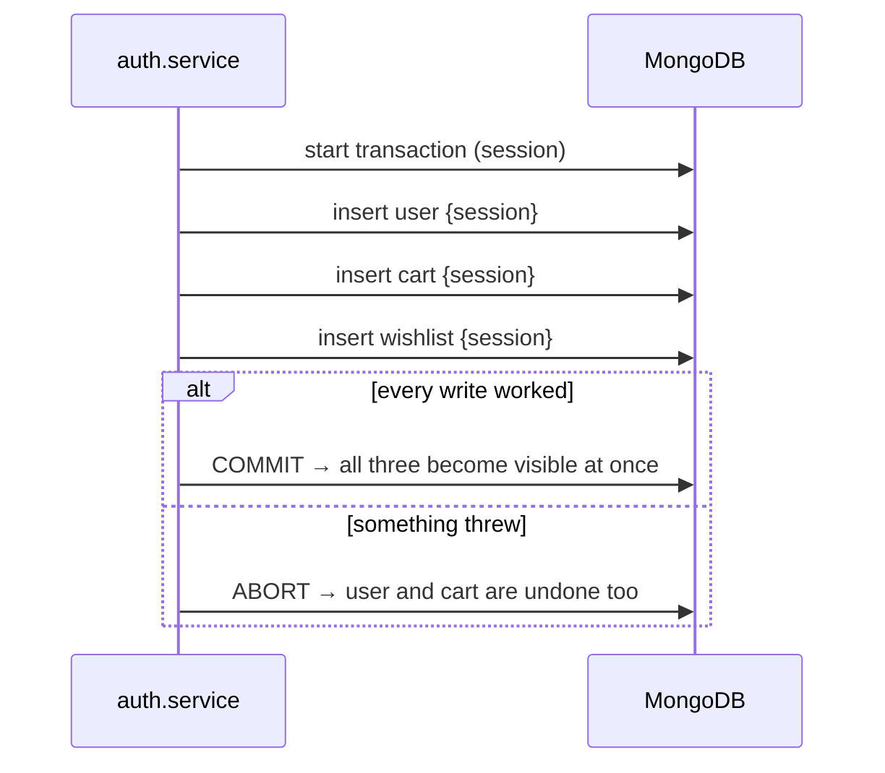

# 18 – Transactions, atomic updates and server-side prices

Branch 05 (cart & wishlist) is the first place where **several writes must succeed or fail together**, and where **money** is calculated. This doc explains the ideas behind that code in plain words. Branch 02 already used a small transaction for the default address ([14](14-authorization-ownership.md)); here we look at the idea properly.

## 1. Atomic = "all or nothing"

An operation is **atomic** when nobody can ever see it half-done. It either happened completely, or not at all.

Think of a bank transfer: "take Rs 1,000 from Ali" **and** "give Rs 1,000 to Sara". If the server crashes between the two steps, money disappears. The two steps must be one atomic unit.

In MongoDB there are two tools for this:

| Tool                                                                    | Scope                                         | Example in this repo                                   |
| ----------------------------------------------------------------------- | --------------------------------------------- | ------------------------------------------------------ |
| **One update operator** (`$addToSet`, `$pull`, `$inc`, `$setOnInsert`…) | ONE document                                  | Wishlist add, cart remove/clear, `Cart.forUser` upsert |
| **A transaction**                                                       | MANY documents, even in different collections | Sign-up: user + cart + wishlist                        |

Rule of thumb: **if one document is enough, use one atomic update. Use a transaction only when you must change several documents together.** Transactions are slower and need a replica set.

## 2. Transactions

A **transaction** groups several writes. MongoDB keeps them "on hold" until you **commit**. If anything throws before that, you **abort** and every write in the group is **rolled back** (undone), as if it never happened.



The code (`server/src/modules/auth/auth.service.js`):

```js
await mongoose.connection.transaction(async (session) => {
  user = new User(data);
  await user.save({ session }); // part of the transaction
  await Cart.create([{ user: user._id }], { session });
  await Wishlist.create([{ user: user._id }], { session });
});
```

Three things beginners get wrong:

1. **Forgetting `{ session }`.** A write without the session runs OUTSIDE the transaction, so it is NOT rolled back. Every write inside must carry it.
2. **Side effects inside the transaction.** `connection.transaction()` may **retry** the function on a temporary conflict. Sending an email inside would send it twice. So `registerUser` sends the verification email **after** the transaction committed.
3. **Expecting it to work everywhere.** Transactions need a **replica set**. MongoDB Atlas is one, our Docker Mongo and the in-memory test database (`tests/setup/globalSetup.js`) are started as one-member replica sets.

How do we _prove_ the rollback works? `tests/integration/signupTransaction.test.js` makes `Wishlist.create` fail on purpose with `jest.spyOn(...).mockRejectedValueOnce(...)` and then checks that **no user and no cart** were left behind.

## 3. Upsert: "get it, or create it" in one step

An **upsert** is an update that **inserts** the document when nothing matches:

```js
Cart.findOneAndUpdate(
  { user: userId }, // find MY cart
  { $setOnInsert: { user: userId, items: [] } }, // only used when it is created
  { upsert: true, new: true },
);
```

Why not "find, and if null then create"? Because two requests at the same moment could both see "null" and both create a cart. The upsert happens inside MongoDB as one step, and the **unique index on `user`** makes a second cart impossible. Users created before branch 05 (or the seeded admin) have no cart; the upsert heals that silently.

## 4. Idempotent operations

An operation is **idempotent** when doing it twice has the same result as doing it once.

| Request                                 | Idempotent? | Why                                                        |
| --------------------------------------- | ----------- | ---------------------------------------------------------- |
| `POST /api/wishlist/:id`                | ✅ yes      | `$addToSet` adds the id only if it is not there yet        |
| `DELETE /api/wishlist/:id`              | ✅ yes      | `$pull` of a missing id changes nothing; still 200         |
| `DELETE /api/cart/items/:id`            | ✅ yes      | same, with `$pull`                                         |
| `POST /api/cart/items`                  | ❌ no       | adding 2 mugs twice = 4 mugs (that is what a shop expects) |
| `PUT /api/cart/items/:id {quantity: 3}` | ✅ yes      | "set to 3" twice is still 3                                |

Idempotency matters because networks retry and users double-click. The heart icon on a product card can be pressed twice without creating a duplicate.

## 5. Atomic "add if not full"

The wishlist may hold at most 100 products. The naive code has a race:

```js
// ❌ two parallel requests can both read 99 and both push → 101
const list = await Wishlist.findOne({ user });
if (list.products.length >= 100) throw ...;
list.products.push(id); await list.save();
```

The atomic version puts the check **into the filter** of the update:

```js
// ✅ "only if position 99 does NOT exist", i.e. fewer than 100 items
Wishlist.updateOne(
  { user, "products.99": { $exists: false } },
  { $addToSet: { products: id } },
);
// matchedCount 0 → the list is full → 400
```

Filter and update run as **one** operation inside MongoDB, so nothing can slip in between.

## 6. Embedded sub-documents

A cart line (`{ product, quantity }`) lives **inside** the cart document, in the `items` array. That is an **embedded sub-document**.

| Embed (cart lines, wishlist ids)                       | Separate collection (addresses, orders) |
| ------------------------------------------------------ | --------------------------------------- |
| Small, bounded list (≤ a few dozen)                    | Can grow without limit                  |
| Always read together with the parent                   | Read or edited one by one               |
| Never exists without the parent                        | Has its own life (orders keep history)  |
| One read, and one-document updates are atomic for free | Needs its own id, indexes and queries   |

Because the whole cart is one document, `$pull` on `items` or saving the cart is atomic without any transaction.

## 7. Server-side price calculation

**Never trust a price from the client.** Anyone can open the browser's dev tools and send:

```json
{ "productId": "665f…", "quantity": 1, "price": 1 }
```

So:

- the cart stores only `product` and `quantity`, **no price**;
- `cart.service.js` reads the **current** price from the `Product` collection every time the cart is shown;
- `utils/pricing.js` computes shipping (Rs 250, free from Rs 5,000) and the total;
- any `price` or `total` in the request body is never read. A test proves it (`IGNORES a price … – price tampering`).

All amounts are **whole rupees** (integers). `0.1 + 0.2` is `0.30000000000000004` in JavaScript, but `1200 * 3` is exactly `3600`. Money stays exact.

In branch 07 the order will **copy** the prices into itself at checkout (a _snapshot_), because an order must keep the price that was actually paid, even if the product price changes later. The cart, by contrast, should always show today's price.

## Where this shows up

| Idea                                 | File                                              |
| ------------------------------------ | ------------------------------------------------- |
| Transaction (user + cart + wishlist) | `server/src/modules/auth/auth.service.js`         |
| Transaction (default address)        | `server/src/modules/addresses/address.service.js` |
| Upsert `forUser`                     | `cart.model.js`, `wishlist.model.js`              |
| Idempotent `$addToSet` / `$pull`     | `wishlist.model.js`, `cart.service.js`            |
| Atomic limit in the filter           | `wishlist.model.js` → `addProduct`                |
| Embedded sub-documents               | `cart.model.js` → `cartItemSchema`                |
| Server-side prices                   | `cart.service.js`, `utils/pricing.js`             |

## Check yourself

1. Remove `{ session }` from `Cart.create` in `auth.service.js` and run `npm test -- signupTransaction`. Which test fails and why?
2. Why is `POST /api/cart/items` _not_ idempotent, and is that a bug?
3. Write the naive "find, check length, push" wishlist add and fire 5 parallel requests at a list with 98 items. How many end up saved?
4. Why does the cart re-read prices, but an order (branch 07) copies them?
