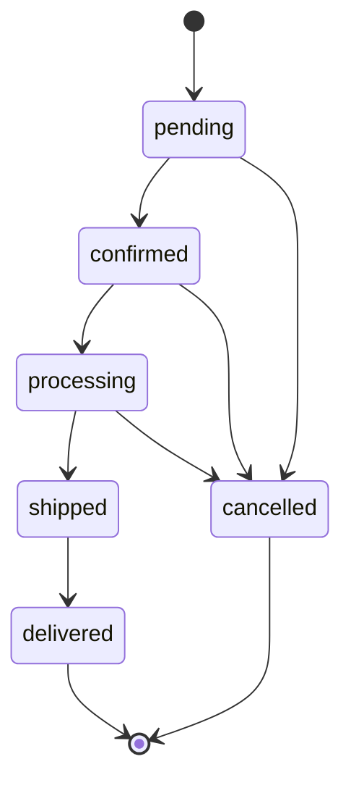

# 21 – State machines and snapshots

Two ideas that make an order trustworthy:

- a **state machine** decides how an order may change over time;
- a **snapshot** makes sure what the customer bought never changes.

## 1. State machines

A **state machine** is a thing that is always in exactly **one** state, plus a fixed list of allowed **transitions** (arrows) between states. Anything not on the list is impossible.

A traffic light is one: green → yellow → red → green. It never jumps from green straight to red.

Our order:



### How it is built here

**1. The arrows are data**, in one table (`config/constants.js`):

```js
export const ORDER_TRANSITIONS = Object.freeze({
  pending: ["confirmed", "cancelled"],
  confirmed: ["processing", "cancelled"],
  processing: ["shipped", "cancelled"],
  shipped: ["delivered"],
  delivered: [], // final state: no way out
  cancelled: [], // final state
});
```

**2. One method is the only door** (`order.model.js`):

```js
order.canTransitionTo("shipped"); // true/false: is there an arrow?
order.changeStatus("shipped", { by: adminId, trackingNumber: "TCS123" });
// → refuses with 400 if there is no arrow, sets side effects, writes statusHistory
```

**3. Side effects belong to the transition**, not to the route: delivering a COD order marks it `paid`; cancelling sets `cancelledAt` and `cancelReason`. Every caller (admin route, customer cancel, the Stripe webhook in branch 08) gets the same behaviour for free.

**4. History**: every change appends `{ status, note, changedBy, at }` to `statusHistory`. That is an **audit trail**: support can answer "who cancelled this, and why?".

### Why bother?

Without a state machine, each route writes `order.status = req.body.status` and carries its own `if`s. Sooner or later one route forgets a rule, and a delivered order becomes "pending" again, or a cancelled order gets shipped. With a table and one door:

- the rules are readable in 8 lines;
- an invalid move is impossible from **any** route;
- testing is easy: loop over every (from, to) pair and compare with the table (`tests/unit/order.model.test.js` does exactly that: 36 cases).

Different **actors** can have extra rules on top: customers may only cancel while `pending` or `confirmed` (`CUSTOMER_CANCELLABLE`), while admins may also cancel during `processing`. Both still go through `changeStatus`.

## 2. Snapshots

A **snapshot** is a copy of data _as it was at one moment_. Orders snapshot three things:

| What      | Copied fields                                         | Why not just keep the id?                                                                   |
| --------- | ----------------------------------------------------- | ------------------------------------------------------------------------------------------- |
| Each item | name, slug, sku, image, **price**, quantity, subtotal | The admin raises the price next week. The receipt must still say what the customer **paid** |
| Address   | fullName, phone, lines, city, province, postal code   | The customer edits or deletes the address. The parcel already on its way must not "move"    |
| Coupon    | code, type, value, discount                           | The admin changes the coupon to 50% or deletes it. The order's discount must not change     |

```js
// address.model.js
addressSchema.methods.toSnapshot = function () {
  const {
    fullName,
    phone,
    addressLine1,
    addressLine2,
    city,
    province,
    postalCode,
    country,
  } = this;
  return {
    fullName,
    phone,
    addressLine1,
    addressLine2,
    city,
    province,
    postalCode,
    country,
  };
};
```

We **also** keep the ids (`items.product`, `coupon.coupon`) because they are still useful: restoring stock on cancel, "did you buy this?" for reviews (branch 09), sales reports (branch 10).

### Snapshot vs reference: when to use which?

| Use a **reference** (id only) when…   | Use a **snapshot** (copy) when…                                      |
| ------------------------------------- | -------------------------------------------------------------------- |
| You always want the **current** value | You need the value **as it was** at a moment (legal, money, history) |
| e.g. the cart: shows today's price    | e.g. orders, invoices, contracts                                     |
| e.g. a product's category             | e.g. the shipping address on a parcel label                          |

The cart (branch 05) deliberately stores **no** prices: it always shows today's price. The order stores **only** copied prices. That is the moment the price is "locked in".

### Money tips that go with snapshots

- Store money as **whole numbers** (rupees here; cents/paisa elsewhere). `0.1 + 0.2` is `0.30000000000000004` in JavaScript.
- Store **every part** of the total (`itemsPrice`, `discountPrice`, `shippingPrice`, `taxPrice`, `totalPrice`) and check they add up (the model refuses to save otherwise). Recomputing later with new rules would give a different number.
- The **server** computes all of it. The client's numbers are ignored.

> **Try it**
>
> 1. Place an order in Postman (folder **07 Orders**). In Mongo, change the product's price. `GET /api/orders/:id` still shows the old price.
> 2. Add a new status `returned` reachable only from `delivered`. Change only `constants.js`, then run `npm test -- tests/unit/order.model.test.js`. Which new cases appear?

## Check yourself

1. What makes something a state machine?
2. Why is `changeStatus` the only code that may write `status`?
3. Why does an order copy the price instead of only storing the product id?
4. Why does the order still keep the product id?
5. The cart shows today's price and the order shows yesterday's. Is that a bug?

## In this repo

- `server/src/config/constants.js` (`ORDER_STATUS`, `ORDER_TRANSITIONS`, `CUSTOMER_CANCELLABLE`)
- `server/src/modules/orders/order.model.js` (`canTransitionTo`, `changeStatus`, snapshot sub-schemas)
- `server/src/modules/addresses/address.model.js` (`toSnapshot`)
- `server/tests/unit/order.model.test.js`
