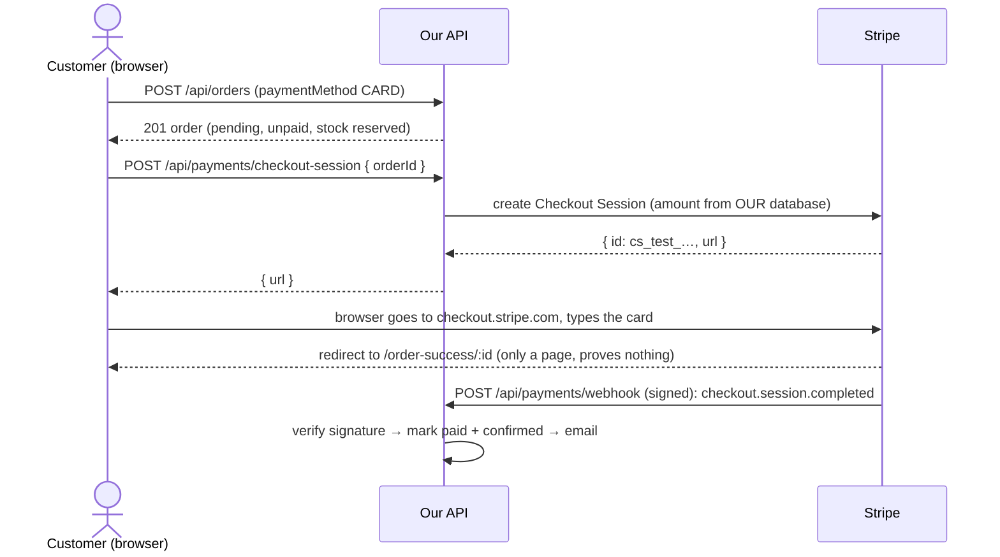

# 22 – Payment providers, webhooks, signatures and idempotency

Branch 08 lets customers pay by card. It brings in five ideas you'll meet in almost every real backend: **hosted checkout**, **webhooks**, **signatures**, **idempotency** and **cron jobs**. One rule ties them together: _the browser can never be the one that says "paid"._

## 1. Payment providers and hosted checkout

A **payment provider** (Stripe, PayPal, a local bank gateway…) is a company that moves money from a card to your bank account. We never touch card numbers ourselves. Storing or even receiving them would put our server under strict card-security rules (PCI DSS).

With **hosted checkout**, the provider shows the payment page on _its_ domain:



The amount sent to Stripe comes from **our** order (`order.totalPrice`), never from the request body. Otherwise a customer could send `"amount": 1`.

## 2. Webhooks: the provider calls _you_

A normal API call goes **client → server**. A **webhook** is the other way round: the _provider's_ server makes an HTTP request to a URL _you_ registered, whenever something happens ("payment succeeded", "refund issued"). Think of it as a reverse API call, or a doorbell.

Why not just trust the redirect to `success_url`? Because:

- the customer can close the tab before the redirect, and the payment still happened;
- anyone can type `/order-success/123` into the address bar without paying;
- some payment methods only succeed minutes or hours later (`async_payment_succeeded`).

The webhook is the provider telling you directly, server to server, what really happened.

## 3. Signatures: is this request really from Stripe?

`/api/payments/webhook` is a public URL. Anybody can POST `{"type":"checkout.session.completed"}` to it. So every webhook carries a **signature**:

```
Stripe-Signature: t=1700000000,v1=5257a869e7ecebeda32affa62cdca3fa51cad7e77a0e56ff536d0ce8e108d8bd
```

- Stripe and our server share a secret, the **webhook signing secret** (`whsec_…`, env `STRIPE_WEBHOOK_SECRET`).
- Stripe computes `HMAC-SHA256(secret, timestamp + "." + rawBody)` and sends it as `v1`.
- We compute the same thing. If the results match, only someone who knows the secret could have made it, so it is Stripe, and **the body was not changed on the way**.
- The timestamp `t` must be recent (5 minutes). An attacker who recorded an old real webhook can't **replay** it later.

An **HMAC** is a fingerprint of a message that needs a secret key to create. Change one byte of the message, or use another key, and the fingerprint is completely different. (Your JWT login tokens from [05](05-jwt-and-sessions.md) are signed the same way.)

### Why the raw body matters

The signature is computed over the **exact bytes** Stripe sent. `express.json()` turns those bytes into a JS object. If you `JSON.stringify` it again you get _equivalent_ JSON, but not always the _same bytes_ (spaces, key order, number formats). The check would fail. So `app.js` registers the webhook route **before** `express.json()`, with `express.raw({ type: 'application/json' })`, which keeps the body as a `Buffer`:

```js
// app.js – order matters
app.post(
  "/api/payments/webhook",
  express.raw({ type: "application/json" }),
  stripeWebhook,
);
app.use(express.json({ limit: "100kb" })); // every OTHER route gets parsed JSON
```

A test proves it: the same event, pretty-printed (`JSON.stringify(event, null, 2)`), is refused with 400.

## 4. Why the client can never mark an order paid

| Who says "paid"?                                            | Can it be faked?             | Used?                          |
| ----------------------------------------------------------- | ---------------------------- | ------------------------------ |
| The browser (`PATCH /orders/:id { paymentStatus: 'paid' }`) | Yes: Postman, curl, devtools | **Never.** No route accepts it |
| Landing on `success_url`                                    | Yes: type the URL            | Only to _show_ a page          |
| A webhook signed with our secret                            | Only if the secret leaks     | **Yes, the only way**          |

In this codebase the only lines that set `paymentStatus: 'paid'` on a card order are inside `markOrderPaid()` in `payment.service.js`, and the only way to reach it is through a valid signature. (Cash on Delivery orders become paid when the admin marks them delivered.)

## 5. Idempotency: safe to do twice

Stripe guarantees **at-least-once** delivery: if our server is slow or answers with an error, it **retries**, for up to three days. The same event can arrive two, three or ten times, sometimes at the same moment. An operation is **idempotent** when doing it twice has the same effect as doing it once (like pressing a lift button twice).

What could go wrong without it: the order is confirmed twice, two "thank you" emails go out, two history entries are added.

How `markOrderPaid` stays idempotent:

1. **Check the state:** order already `paid` → answer 200 `already-paid` and do nothing.
2. **Atomic claim for races:** two deliveries can both read "pending" at the same time. So the actual update is conditional:
   ```js
   Order.findOneAndUpdate(
     { _id: order._id, paymentStatus: 'pending' }, // only matches if nobody did it yet
     { $set: { paymentStatus: 'paid', … } },
   );
   ```
   MongoDB applies single-document updates one at a time. Only **one** delivery gets the document back. The others get `null` and stop. A test fires three deliveries with `Promise.all` and expects exactly one `paid` and one email.
3. **Always answer 2xx for events we've handled or chosen to ignore**, so Stripe stops retrying. Answer 4xx/5xx only when we _want_ a retry (bad signature, database down).

Other systems store every processed **event id** in a table and skip ids they have seen. That works too. Here, the order's own state is enough.

## 6. Cron jobs: work nobody asked for

A card order reserves stock the moment it is placed. If the customer walks away from the Stripe page, that stock would be blocked forever. A **cron job** is a task a scheduler runs on a timetable. The name comes from the Unix `cron` tool and its time format:

```
┌ minute (0-59)  ┌ hour (0-23)  ┌ day of month  ┌ month  ┌ day of week
0                3              *               *        *        → every day at 03:00 (UTC)
```

On Vercel there is no always-running process, so **Vercel Cron** calls a URL (`server/vercel.json` → `/api/payments/expire-unpaid`) and sends `Authorization: Bearer <CRON_SECRET>`. The job:

- finds CARD orders still `pending` + unpaid after 30 minutes (`PAYMENTS.UNPAID_CARD_EXPIRY_MS`),
- cancels each one in a transaction and **gives the stock and coupon use back** (`cancelWithRestore`),
- is itself idempotent: a second run finds nothing to do,
- re-checks "still unpaid" inside the cancel, so a payment that lands at the same millisecond wins and is never cancelled.

The URL is public, so it's protected by a **shared secret**. No secret → 401, wrong secret → 403. The comparison uses `crypto.timingSafeEqual`, so response times don't reveal how many characters of a guess were right.

> Vercel's free plan runs crons at most once a day. The checkout route therefore _also_ refuses to pay for an order older than 30 minutes, so the rule holds even between job runs. For tighter timing, call the same URL from any external scheduler with the `x-cron-secret` header.

## Check yourself

1. Why can't the webhook route sit after `express.json()`? What would happen to every real Stripe call?
2. An attacker copies a real, correctly signed webhook from your logs and sends it again an hour later. What stops it?
3. Two webhook deliveries for one order arrive in the same millisecond. Walk through `markOrderPaid` for both. Which line makes sure only one email is sent?
4. Why does the webhook answer **200** for an event type we don't handle, but **400** for a bad signature?
5. The expiry job and the webhook run at the same moment for the same order. Which filter prevents a paid order from being cancelled?

Related: [05 – JWT and sessions](05-jwt-and-sessions.md) (signatures), [08 – Security basics](08-security-basics.md), [14 – Ownership](14-authorization-ownership.md), module guide [08 – Payments](../modules/08-payments.md).
