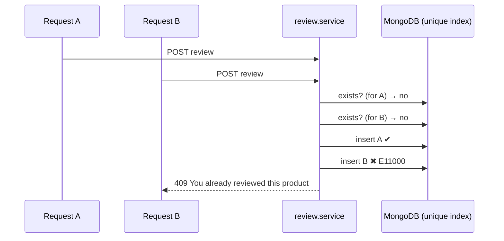
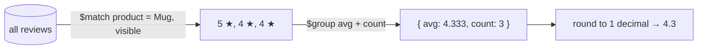

# 23 – Ratings: aggregation pipelines, denormalized counters, compound unique indexes and moderation

Branch 09 (reviews) adds four ideas at once. They all answer one product-page question: **"★ 4.3 (12 reviews)": where does that number come from, and how do we keep it honest?**

## 1. Compound unique index: "one voice per customer"

[10 – Databases and indexes](10-databases-and-indexes.md) showed a **unique** index on one field (a user's `email`). A **compound** index is built from **several fields together**. Making it unique means MongoDB refuses a second document with the same **combination** of values.

```js
// review.model.js
reviewSchema.index(
  { product: 1, user: 1 },
  { unique: true, name: "one_review_per_product" },
);
```

| Existing reviews | New review    | Allowed?                    |
| ---------------- | ------------- | --------------------------- |
| (Mug, Ali)       | (Kettle, Ali) | ✅ different product        |
| (Mug, Ali)       | (Mug, Sara)   | ✅ different customer       |
| (Mug, Ali)       | (Mug, Ali)    | ❌ **E11000 duplicate key** |

Why not just check in code ("does a review exist? no → create")? Because two requests can arrive at the **same millisecond** (a double-click on "Submit"). Both checks see "no review yet", and both create one. That's a **race condition**. The unique index is checked inside the database, one write at a time, so only one of them can win:



So we do **both**: the friendly check gives a clear 409 in the normal case, and the index (plus a `catch` for code `11000`) covers the race. The test `two simultaneous submits create exactly ONE review` proves it.

> The order of fields matters for **queries**, not for uniqueness. `{ product: 1, user: 1 }` also speeds up "all reviews of product X", because `product` comes first (the "leftmost prefix" rule).

## 2. Aggregation pipeline: let the database do the maths

`find()` returns documents. An **aggregation pipeline** returns **calculated results**. It's a list of **stages**. Each stage receives the documents from the previous one, transforms them, and passes them on, like an assembly line:

```js
// review.model.js → Review.calcProductRating(productId)
Review.aggregate([
  { $match: { product: productId, isVisible: true } }, // 1. filter
  { $group: { _id: "$product", avg: { $avg: "$rating" }, count: { $sum: 1 } } }, // 2. squash
]);
// → [ { _id: <productId>, avg: 4.333…, count: 3 } ]   (or [] when there are none)
```



| Stage                                    | SQL cousin                                 | What it does                                                                             |
| ---------------------------------------- | ------------------------------------------ | ---------------------------------------------------------------------------------------- |
| `$match`                                 | `WHERE`                                    | keep only matching documents (put it **first** so an index can help)                     |
| `$group`                                 | `GROUP BY`                                 | combine many documents into one per `_id`, with accumulators like `$avg`, `$sum`, `$max` |
| `$sort`, `$limit`, `$project`, `$lookup` | `ORDER BY`, `LIMIT`, `SELECT cols`, `JOIN` | (used in later branches, e.g. admin reports)                                             |

Why not load the reviews into Node and add them up there? A popular product can have thousands of reviews. The pipeline sends **one tiny object** over the network instead of thousands of documents.

⚠️ `aggregate()` does **not** convert types the way `find()` does. A string id must become an `ObjectId` first (`new mongoose.Types.ObjectId(id)`), or `$match` silently finds nothing.

## 3. Denormalized counter: store the answer, not only the question

**Normalized** data stores each fact once. The rating would then only exist inside the reviews, and every product card on every page would run the pipeline above. A category page with 24 products means 24 aggregations per visit. That's too slow, and it also makes **"sort by rating"** impossible with a normal index.

**Denormalized** data stores a fact **twice on purpose**: the reviews stay the source of truth, and the product keeps a ready-made copy.

```js
// product document
{ name: 'Steel Kettle', price: 2500, ratingAverage: 4.3, ratingCount: 3, ... }
```

|                         | Normalized (calculate on read)    | Denormalized (store on write)                                         |
| ----------------------- | --------------------------------- | --------------------------------------------------------------------- |
| Product list / card     | slow: one aggregation per product | fast: just read two fields                                            |
| Sort / filter by rating | needs an aggregation              | normal index `{ isActive: 1, ratingAverage: -1 }`                     |
| Writing a review        | one write                         | one write **+ one recalculation**                                     |
| Risk                    | none                              | the copy can get **out of sync** if a write path forgets to update it |

Reads (people browsing) happen far more often than writes (people reviewing), so the trade is worth it. The price is **discipline**: every write path must refresh the copy. We put that in the model, as Mongoose **post hooks** that run after the write succeeded:

| Write                               | Hook                       | Who triggers it                      |
| ----------------------------------- | -------------------------- | ------------------------------------ |
| `Review.create()` / `review.save()` | `post('save')`             | customer writes a review             |
| `Review.findOneAndUpdate()`         | `post('findOneAndUpdate')` | customer edits; admin hides or shows |
| `Review.findOneAndDelete()`         | `post('findOneAndDelete')` | author or admin deletes              |

Each hook calls `calcProductRating(product)`, which **recalculates from scratch** rather than doing `+1` / `-1` arithmetic. Recalculating is a little slower, but it **self-heals**: if the copy was ever wrong, the next review fixes it.

⚠️ Bulk operations (`updateMany`, `deleteMany`) do **not** run these hooks. Use them only when the product itself is going away, or recalculate by hand afterwards.

## 4. Moderation: hide, don't destroy

Public user content attracts spam, insults and fake reviews. **Moderation** means the shop can control what the public sees. There are two tools with different weights:

| Action     | Route                                                      | Data kept? | Counts in the average? | Undo?            |
| ---------- | ---------------------------------------------------------- | ---------- | ---------------------- | ---------------- |
| **Hide**   | `PATCH /api/reviews/:id/visibility` `{ isVisible: false }` | ✅ yes     | ❌ no                  | ✅ show it again |
| **Delete** | `DELETE /api/reviews/:id` (admin may delete any review)    | ❌ no      | ❌ no                  | ❌ gone          |

Hiding is the safer default: a moderator can make a mistake, a customer can complain, and the evidence stays. Notice that `isVisible` lives in the **database filter** of the public list (`{ product, isVisible: true }`) _and_ in the pipeline's `$match`, so a hidden review vanishes from both the page and the number. Customers can never set `isVisible` themselves: the service ignores it in the body (mass assignment protection, see [06](06-validation-and-trust.md)).

## Putting it together: "verified buyer"

The rating is only worth something if the reviewers really bought the product. Before saving, the service looks for **a DELIVERED order of this customer that contains this product**:

```js
Order.findOne({
  user: userId,
  status: "delivered",
  "items.product": productId,
});
```

`'items.product'` searches **inside the array** of order items. That order's id is stored on the review (`review.order`) as proof. No delivered order → **403**. That covers a pending order, a shipped order, a cancelled order, and someone else's order.

## Try it

1. In `mongosh`, run the pipeline by hand: `db.reviews.aggregate([{ $match: { isVisible: true } }, { $group: { _id: '$product', avg: { $avg: '$rating' }, n: { $sum: 1 } } }])`.
2. Remove the `post('findOneAndDelete')` hook and run `npm test -- -t "recalculates"`. Which assertion fails, and why?
3. Change the rounding to two decimals. Which tests break? Is two decimals better for customers?
4. Design question: add a `ratingDistribution` (`{ 5: 10, 4: 3, ... }`) to the product. Which pipeline stage would you add, and what is the write cost?

Related: [10 – Databases and indexes](10-databases-and-indexes.md) · [14 – Ownership](14-authorization-ownership.md) · Module guide: [09 – Reviews](../modules/09-reviews.md)
