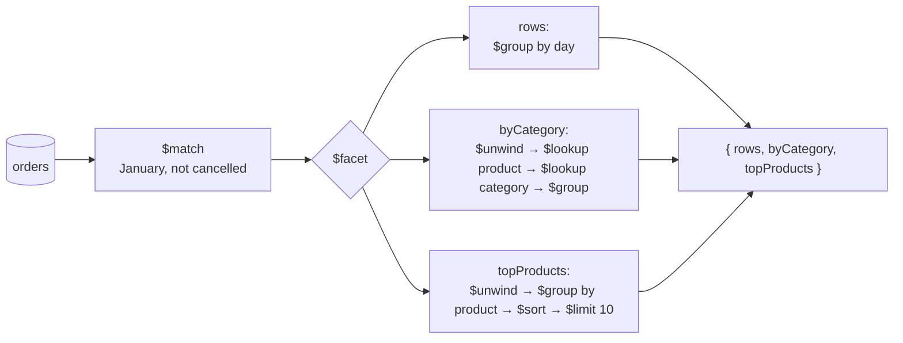
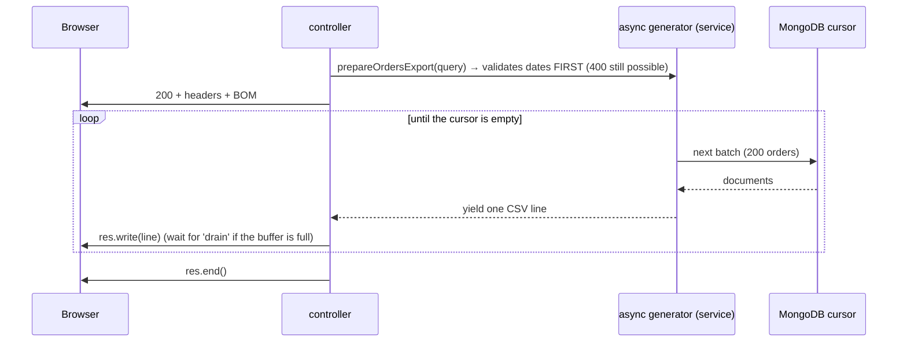

# 24 – Reporting: aggregation pipelines, time zones, CSV, admin lists and seeding

Branch 10 builds the **admin area**. Its endpoints don't create much data; they **summarise** it. That brings six new ideas:

1. [Aggregation pipelines](#1-aggregation-pipelines-match-group-facet) – let the database do the maths
2. [Dates and time zones in reports](#2-dates-and-time-zones-in-reports) – "which day was that order?"
3. [CSV export and streaming](#3-csv-export-and-streaming) – files that Excel can open, safely, at any size
4. [Pagination and search](#4-pagination-and-search) – big lists, one page at a time
5. [Least privilege for admin](#5-least-privilege-for-admin) – powerful routes, tight guards
6. [Seeding and idempotency](#6-seeding-and-idempotency) – a store that works on first start

---

## 1. Aggregation pipelines ($match, $group, $facet)

**The naive way** to compute "revenue in the last 30 days": load every order into Node and add up `totalPrice` in a loop. With 50 000 orders, that moves megabytes over the network just to return **one number**.

**The aggregation way:** send MongoDB a list of **stages**. Each stage receives the documents of the previous one, like an assembly line, and only the small answer comes back.

```js
Order.aggregate([
  { $match: { createdAt: { $gte: from }, status: "delivered" } }, // 1. keep only some orders
  { $group: { _id: null, revenue: { $sum: "$totalPrice" } } }, // 2. squash them into one row
]);
// → [{ _id: null, revenue: 8250 }]
```

| Stage             | Plain words                                                               | SQL cousin                      |
| ----------------- | ------------------------------------------------------------------------- | ------------------------------- |
| `$match`          | keep only documents that match a filter                                   | `WHERE`                         |
| `$group`          | one output row per `_id` key, with accumulators `$sum`, `$avg`, `$first`… | `GROUP BY`                      |
| `$unwind`         | an order with 3 items becomes 3 documents (one per item)                  | joining a child table           |
| `$lookup`         | fetch matching documents from another collection                          | `LEFT JOIN`                     |
| `$sort`, `$limit` | order and cut                                                             | `ORDER BY`, `LIMIT`             |
| `$project`        | choose, rename or compute fields                                          | the `SELECT` list               |
| `$facet`          | run **several sub-pipelines on the same input**, in one round trip        | several queries over one `WITH` |



Rules of thumb used in `admin.service.js`:

- **`$match` first.** It can use an index (`orders.createdAt`), and every later stage then sees fewer documents.
- **`_id: null`** in `$group` means "one group for everything" (a grand total).
- **Nested `$sum`**: `{ $sum: { $sum: '$items.quantity' } }`. The inner `$sum` adds the quantities of _one_ order's array, and the outer one adds the orders up.
- **`$cond`** is an if/else inside the database: `{ $sum: { $cond: [isActive, 1, 0] } }` counts active products.
- **Deterministic sorting**: `{ $sort: { sold: -1, _id: 1 } }`. Ties are broken by `_id`, so the result is the same every time. Tests depend on that, and so do users.
- **Snapshots, not joins**: top products use `items.name` from the order (the name _at the time of sale_). A product renamed or deleted later doesn't change old reports. When we do need a join (category per sale), a missing product goes to an **"Uncategorised"** row rather than silently disappearing.
- **No answer ≠ zero.** `$group` over zero documents produces _no row_, so the code writes `revenueAgg[0]?.revenue || 0`.

`Promise.all([...])` is the other speed trick on the dashboard: ten independent queries run **at the same time**, so the page waits for the slowest one, not for the sum of all ten.

## 2. Dates and time zones in reports

MongoDB stores every date in **UTC**, one clock for the whole world. That's correct for storage, but people think in **local days**.

> An order placed at **01:30 on 6 January in Lahore** (UTC+5) is stored as **20:30 on 5 January UTC**.
> A "daily sales" report in UTC puts it on the 5th. A shop owner in Pakistan expects the 6th.

Two places need the time zone:

| Where                                             | What we do                                                                                                                                                                                            |
| ------------------------------------------------- | ----------------------------------------------------------------------------------------------------------------------------------------------------------------------------------------------------- |
| **The period** (`?from=2026-01-01&to=2026-01-31`) | `startOfDayInZone('2026-01-01', tz)` → the exact UTC instant of local midnight (`2025-12-31T19:00:00Z` for Karachi). `endOfDayInZone` → the last millisecond of the `to` day, so `to` is **included** |
| **The buckets** (`$group` by day)                 | `$dateToString: { format: '%Y-%m-%d', date: '$createdAt', timezone: tz }`: MongoDB names each order's day in that zone                                                                                |

Details that matter:

- `?tz=` takes **IANA names** (`Asia/Karachi`, `Europe/London`). Never fixed offsets like `+05:00`: offsets change with daylight saving, and names know the rules. We check them with `Intl.DateTimeFormat`, which throws on unknown zones.
- On a daylight-saving day a "day" is **23 or 25 hours** long. That's why `utils/dates.js` asks for the offset _at the instant in question_ instead of adding `24 h`. A unit test covers New York on 8 March 2026.
- **Default `UTC`** keeps the numbers identical to the reference server; Pakistan's shops can pass `tz=Asia/Karachi`.
- Week buckets use **ISO weeks** (`%G-W%V`, e.g. `2026-W02`): weeks start on Monday, and week 1 is the week with the year's first Thursday. That's why 1–4 January 2026 belong to `2026-W01` and 5 January starts `W02`.
- Requests take **calendar days** (`YYYY-MM-DD`), not timestamps, and `isISO8601({ strict: true })` refuses `2026-02-30`.
- A **maximum period** (366 days) stops one request from scanning years of data.
- Rolling windows ("last 30 days") are computed from `now`, and the service accepts `now` as a parameter so tests could freeze the clock.

## 3. CSV export and streaming

**CSV** (comma-separated values) is the lingua franca of spreadsheets. It's simple, but it has traps (RFC 4180 + OWASP):

| Trap                                                                                                                     | Fix in `utils/csv.js`                                                                                                  |
| ------------------------------------------------------------------------------------------------------------------------ | ---------------------------------------------------------------------------------------------------------------------- |
| A cell contains `,` `"` or a line break                                                                                  | Wrap it in quotes and double inner quotes: `He said "hi"` → `"He said ""hi"""`                                         |
| Line endings                                                                                                             | `\r\n` (CRLF)                                                                                                          |
| Excel shows `é` instead of `é`                                                                                          | Start the file with a UTF-8 **BOM** (``)                                                                              |
| **CSV / formula injection**: a customer registers as `=HYPERLINK("http://evil","click")` and the admin's Excel _runs_ it | Text starting with `= + - @ TAB CR` gets a leading `'`, so it's displayed, never executed. Real numbers are left alone |

A download needs two headers:

```http
Content-Type: text/csv; charset=utf-8
Content-Disposition: attachment; filename="sales-report_2026-01-01_2026-01-31.csv"
```

`attachment` tells the browser to save the file. We also send `Cache-Control: no-store`, because reports contain business data and change every minute.

**Small file → build it, send it.** The sales report has at most ~366 rows, so `getSalesReportCsv` builds one string.

**Big file → stream it.** The orders export can be tens of thousands of lines. Building it in memory would use memory proportional to the export. Instead:



- An **aggregation cursor** fetches documents in batches instead of all at once.
- An **async generator** (`async function*` + `yield`) produces lines only when the consumer asks for the next one.
- **Backpressure**: `res.write()` returns `false` when the client is slow. We `await once(res, 'drain')` before writing more, so memory stays flat.
- **Validate before the first byte.** Once `200` has been sent, it can't become `400`. If the database fails half-way, we **destroy the connection**: the browser reports a failed download instead of saving a silently truncated file.

## 4. Pagination and search

`GET /api/admin/users?search=ali&status=active&page=2&limit=20`

- **Pagination** (`utils/pagination.js`): `skip = (page − 1) × limit`, plus `meta: { page, limit, total, pages }` so the UI can draw page buttons. `limit` is **capped** (100): `?limit=1000000` would turn a page into a database dump. Out-of-range values get a **400**, not a silent fix, so client bugs show up.
- **Stable order**: sort by `createdAt` **and** `_id`, otherwise two customers created in the same millisecond could appear on both pages or on neither.
- **Search** uses a case-insensitive RegExp on name and email. User text is **escaped** first: `.*` must mean the two characters ".*", not "match everything", and `(((((` must not crash the regex engine or slow it down (**ReDoS**). A query string like `?search[$ne]=x` arrives as an _object_; `express-mongo-sanitize` strips `$` keys and `isString()` refuses what's left (**400**).
- **Avoid N+1 queries**: order counts for the 20 customers on a page come from **one** `$group` with `user: { $in: ids }`, not 20 separate queries.
- `skip` gets slower on very deep pages. For huge collections, "cursor pagination" (`?after=<lastId>`) is the next step. It's an exercise.

## 5. Least privilege for admin

Admin routes are the most powerful in the API, so they get the tightest guards:

| Practice                                                                                                                                                                                  | Where                 |
| ----------------------------------------------------------------------------------------------------------------------------------------------------------------------------------------- | --------------------- |
| **One guard for the whole router**: `router.use(protect, authorize('admin'))`. A new admin route can't be added "unprotected by accident"                                                 | `admin.routes.js`     |
| **Validate admin input too**: a hijacked admin session or a buggy page must not be able to request "all orders since 1970" or `limit=10⁶`                                                 | `admin.validation.js` |
| **Return only what the screen needs**: customer rows are built field by field (an allow-list); the export's `$lookup` projects only `name` and `email`; `toJSON` strips secrets           | `admin.service.js`    |
| **Customer screens show customers only**: an admin's id gets **404** on `/admin/users/:id`                                                                                                | `getCustomer`         |
| **No self-lockout, no admin-vs-admin**: an admin can't deactivate themselves or another admin (400). Admins are managed with database access (seed script)                                | `setCustomerStatus`   |
| **Deactivation is immediate**: `protect` reloads the user on every request, so a deactivated customer's existing token gets **403 "Account disabled"** at once. No token blacklist needed | `auth.middleware.js`  |
| **Strict booleans**: `isActive` must be a real JSON `true`/`false`. A loose check might turn the string `"false"` into `true`                                                             | `statusRules`         |

## 6. Seeding and idempotency

**Seeding** puts known starting data into a database: an admin, categories, products with pictures, coupons. A fresh install (or a new teammate) then sees a working shop.

**Idempotent** = running it **twice** gives the same result as running it **once**. `npm run seed` is safe to run again and again:

```js
if (await Product.exists({ sku })) continue;   // look up by a NATURAL KEY…
await Product.create({ ... });                 // …create only when missing
```

| Record   | Natural key | Safety net                                                                                        |
| -------- | ----------- | ------------------------------------------------------------------------------------------------- |
| Admin    | `email`     | unique index; **refuses** if that email is a _customer_ (never silently promote someone to admin) |
| Category | `name`      | unique (case-insensitive) index                                                                   |
| Product  | `sku`       | unique index                                                                                      |
| Coupon   | `code`      | unique index                                                                                      |

- **Insert-only, never overwrite**: a re-run doesn't undo an admin's price change. A test proves it.
- `Model.create()` (not raw inserts) runs the **model hooks**: slugs, the two-level category rule, password hashing.
- Parents before children: sub-categories need their parent's `_id`.
- **Testable seed**: `seedStore()` is exported, and the connect/disconnect part only runs from the command line (`process.argv[1]` check). `tests/integration/seed.test.js` runs it twice and asserts identical counts.

---

**See it in code:** `server/src/modules/admin/*`, `server/src/utils/dates.js`, `server/src/utils/csv.js`, `server/src/db/scripts/seed.js`.
**Module guide:** [docs/modules/10-admin.md](../modules/10-admin.md) · **Mind map:** [docs/mind-maps/10-admin.md](../mind-maps/10-admin.md)
