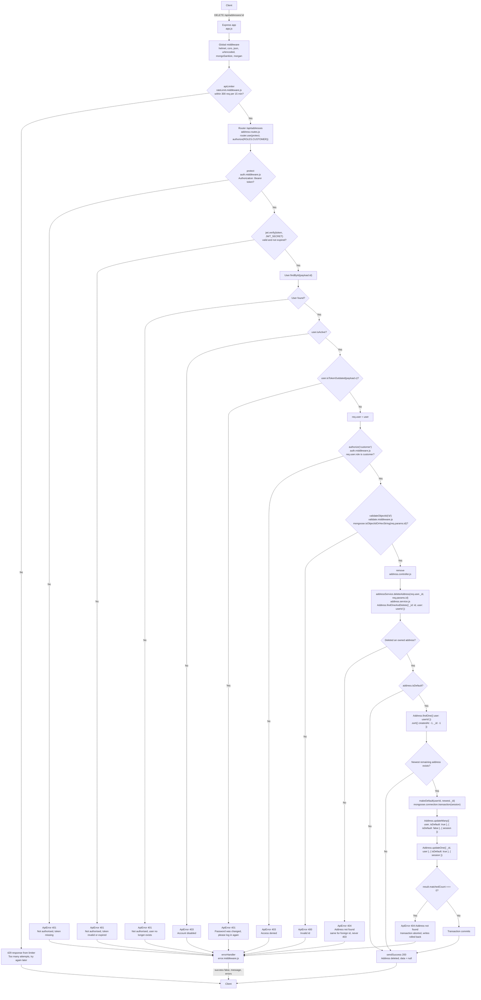

# Delete an address – `DELETE /api/addresses/:id`

Deletes one of the logged-in customer's own addresses. If it was the default, the newest remaining address becomes the default. A foreign or unknown id gives 404. Customers only; admins get 403.

**Files involved:** `server/src/app.js` (global middleware, mounts `/api/addresses`), `server/src/middleware/rateLimit.middleware.js` (`apiLimiter`), `server/src/modules/addresses/address.routes.js` (`router.use(protect, authorize)`, `DELETE /:id`), `server/src/middleware/auth.middleware.js` (`protect`, `authorize`), `server/src/middleware/validate.middleware.js` (`validateObjectId`), `server/src/config/constants.js` (`ROLES`), `server/src/modules/addresses/address.controller.js` (`remove`), `server/src/modules/addresses/address.service.js` (`deleteAddress`, `makeDefault`, `notFound`), `server/src/modules/addresses/address.model.js` (Address model, unique partial index), `server/src/utils/ApiResponse.js` (`sendSuccess`), `server/src/middleware/error.middleware.js` (`errorHandler`).
