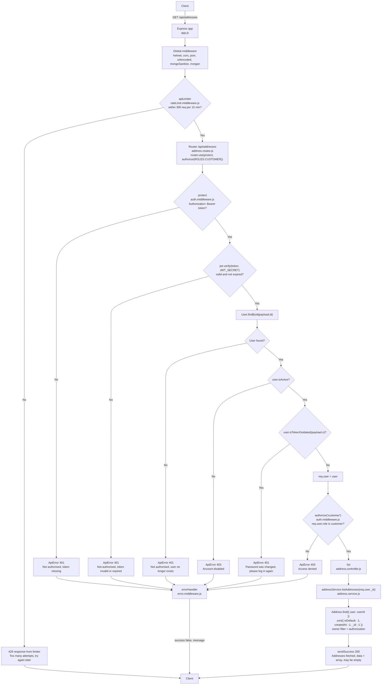

# List my addresses – `GET /api/addresses`

Returns all of the logged-in customer's saved addresses, default first, then newest first. Customers only; admins get 403.

**Files involved:** `server/src/app.js` (global middleware, mounts `/api/addresses`), `server/src/middleware/rateLimit.middleware.js` (`apiLimiter`), `server/src/modules/addresses/address.routes.js` (`router.use(protect, authorize)`, `GET /`), `server/src/middleware/auth.middleware.js` (`protect`, `authorize`), `server/src/config/constants.js` (`ROLES`), `server/src/modules/addresses/address.controller.js` (`list`), `server/src/modules/addresses/address.service.js` (`listAddresses`), `server/src/modules/addresses/address.model.js` (Address model, `{ user: 1, createdAt: -1 }` index), `server/src/utils/ApiResponse.js` (`sendSuccess`), `server/src/middleware/error.middleware.js` (`errorHandler`).
