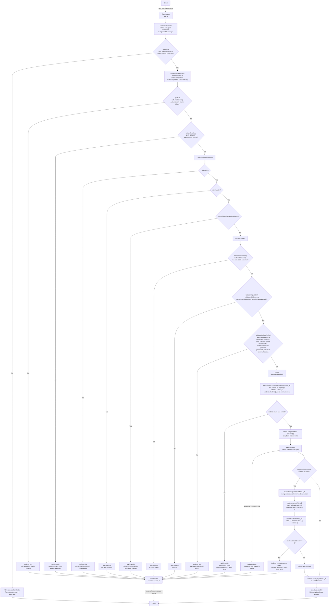

# Update an address – `PUT /api/addresses/:id`

Replaces the fields of one of the logged-in customer's own addresses; `isDefault: true` also moves the default to it (`isDefault: false` is ignored). A foreign or unknown id gives 404. Customers only; admins get 403.

**Files involved:** `server/src/app.js` (global middleware, mounts `/api/addresses`), `server/src/middleware/rateLimit.middleware.js` (`apiLimiter`), `server/src/modules/addresses/address.routes.js` (`router.use(protect, authorize)`, `PUT /:id`), `server/src/middleware/auth.middleware.js` (`protect`, `authorize`), `server/src/middleware/validate.middleware.js` (`validateObjectId`, `validate`), `server/src/modules/addresses/address.validation.js` (`addressRules`), `server/src/config/constants.js` (`ROLES`, `PROVINCES`, `ADDRESS_LABELS`, `REGEX`), `server/src/modules/addresses/address.controller.js` (`update`), `server/src/modules/addresses/address.service.js` (`updateAddress`, `pick`, `makeDefault`, `notFound`), `server/src/modules/addresses/address.model.js` (schema validators, unique partial index), `server/src/utils/ApiResponse.js` (`sendSuccess`), `server/src/middleware/error.middleware.js` (`errorHandler`).
