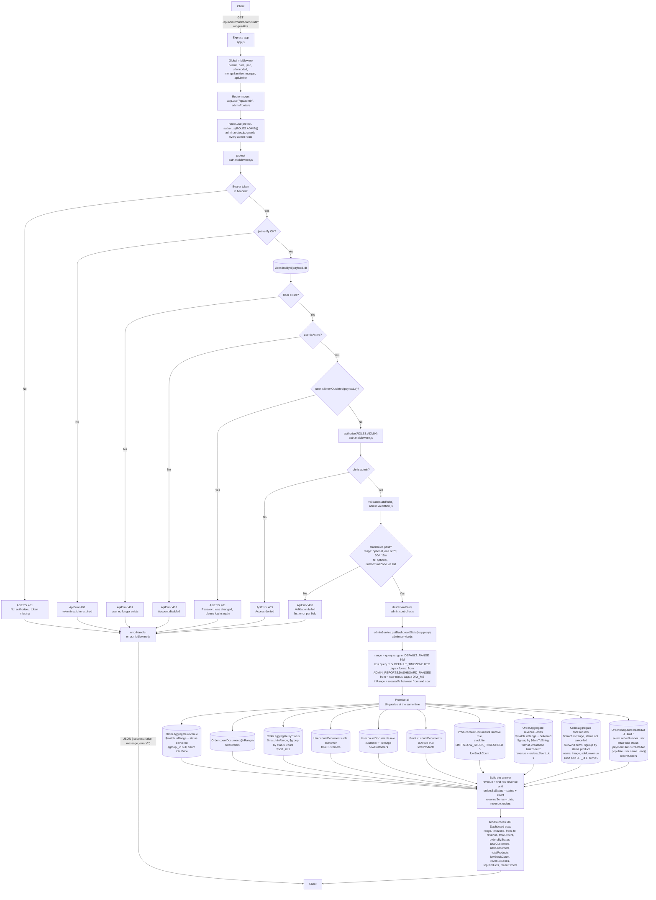

# Dashboard stats (admin) – `GET /api/admin/dashboard/stats`

An admin gets the key numbers for the admin home page over a rolling window (`?range=7d|30d|12m`, default `30d`): delivered revenue, orders per status, customers, active products, low stock, a revenue chart whose days (or months for `12m`) are named in the chosen time zone (`?tz`, default UTC), the 5 best sellers and the 5 newest orders. The ten independent queries run in parallel. Only admins may call it.

**Files involved:** `server/src/app.js` (global middleware, mounts `/api/admin`), `server/src/modules/admin/admin.routes.js` (route, `router.use(protect, authorize(ROLES.ADMIN))`, middleware order), `server/src/middleware/auth.middleware.js` (`protect`, `authorize`), `server/src/middleware/validate.middleware.js` (`validate`), `server/src/modules/admin/admin.validation.js` (`statsRules`, `tzRule`), `server/src/utils/dates.js` (`isValidTimeZone`, `DAY_MS`), `server/src/config/constants.js` (`ADMIN_REPORTS`, `LIMITS.LOW_STOCK_THRESHOLD`, `ORDER_STATUS`, `ROLES`), `server/src/modules/admin/admin.controller.js` (`dashboardStats`), `server/src/modules/admin/admin.service.js` (`getDashboardStats`), `server/src/modules/models.js` (`Order`, `User`, `Product`), `server/src/utils/ApiResponse.js` (`sendSuccess`), `server/src/middleware/error.middleware.js` (error response).
