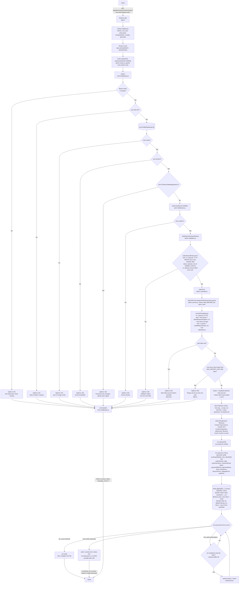

# Export orders as CSV (admin) – `GET /api/admin/reports/orders/export`

An admin downloads every order of a period (optionally only one status) as a CSV file named `orders_<from>_<to>.csv`, one line per order. The dates are checked before anything is sent; the file is then STREAMED from a MongoDB cursor line by line, waiting for `drain` when the client is slow, so memory stays small. An error in the middle of the stream cuts the connection instead of sending JSON. Only admins may call it.

**Files involved:** `server/src/app.js` (global middleware, mounts `/api/admin`), `server/src/modules/admin/admin.routes.js` (route, `router.use(protect, authorize(ROLES.ADMIN))`, middleware order), `server/src/middleware/auth.middleware.js` (`protect`, `authorize`), `server/src/middleware/validate.middleware.js` (`validate`), `server/src/modules/admin/admin.validation.js` (`ordersExportRules`), `server/src/modules/admin/admin.controller.js` (`ordersCsv`, `setCsvHeaders`), `server/src/modules/admin/admin.service.js` (`prepareOrdersExport`, `resolvePeriod`, `ORDER_CSV_HEADER`, `fileDays`), `server/src/utils/csv.js` (`csvRow`, `csvCell`, `CSV_BOM`), `server/src/utils/dates.js` (`startOfDayInZone`, `endOfDayInZone`, `dayInZone`), `server/src/config/constants.js` (`ADMIN_REPORTS`, `ORDER_STATUS`), `server/src/modules/orders/order.model.js` (aggregated through a cursor), `server/src/config/env.js` (`isTest`), `server/src/middleware/error.middleware.js` (error response).
