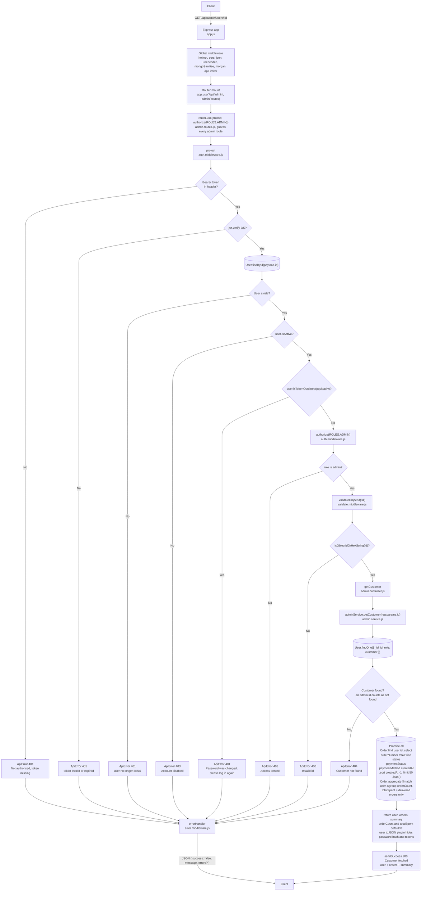

# Customer detail (admin) – `GET /api/admin/users/:id`

An admin opens one customer's page: the profile, their 50 newest orders and a summary (order count, money spent on delivered orders). An admin's id answers the same 404 as an unknown id. Only admins may call it.

**Files involved:** `server/src/app.js` (global middleware, mounts `/api/admin`), `server/src/modules/admin/admin.routes.js` (route, `router.use(protect, authorize(ROLES.ADMIN))`, middleware order), `server/src/middleware/auth.middleware.js` (`protect`, `authorize`), `server/src/middleware/validate.middleware.js` (`validateObjectId`), `server/src/modules/admin/admin.controller.js` (`getCustomer`), `server/src/modules/admin/admin.service.js` (`getCustomer`), `server/src/config/constants.js` (`ROLES`, `ADMIN_REPORTS.CUSTOMER_DETAIL_ORDERS`, `ORDER_STATUS`), `server/src/modules/users/user.model.js` (toJSON plugin), `server/src/modules/orders/order.model.js` (queried), `server/src/utils/ApiResponse.js` (`sendSuccess`), `server/src/middleware/error.middleware.js` (error response).
