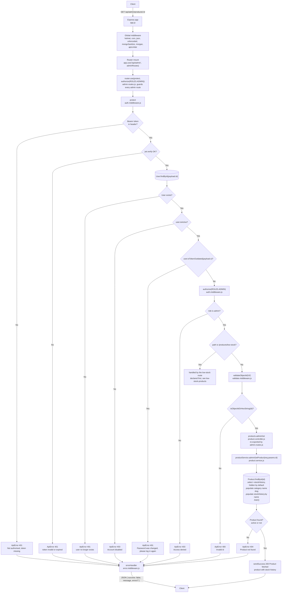

# Get one product for editing (admin) – `GET /api/admin/products/:id`

An admin loads one product by id (active or not) for the edit page, including its stock history and who changed it. `/products/low-stock` is declared before this route, so that word is never read as an id. The handler belongs to the products module and is mounted under `/api/admin`. Only admins may call it.

**Files involved:** `server/src/app.js` (global middleware, mounts `/api/admin`), `server/src/modules/admin/admin.routes.js` (route, `router.use(protect, authorize(ROLES.ADMIN))`, middleware order), `server/src/middleware/auth.middleware.js` (`protect`, `authorize`), `server/src/middleware/validate.middleware.js` (`validateObjectId`), `server/src/modules/products/product.controller.js` (`adminGet`), `server/src/modules/products/product.service.js` (`adminGetProduct`), `server/src/modules/products/product.model.js` (`stockHistory` select false), `server/src/utils/ApiResponse.js` (`sendSuccess`), `server/src/middleware/error.middleware.js` (error response).
