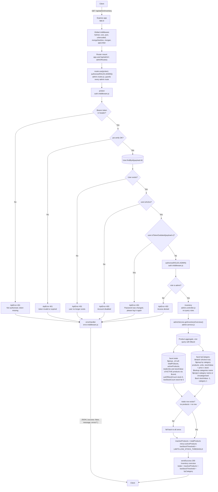

# Inventory overview (admin) – `GET /api/admin/inventory`

An admin gets a stock overview computed in one aggregation: product counts, units and stock value of active products, out-of-stock and low-stock counts, and a per-category table. Only admins may call it.

**Files involved:** `server/src/app.js` (global middleware, mounts `/api/admin`), `server/src/modules/admin/admin.routes.js` (route, `router.use(protect, authorize(ROLES.ADMIN))`, middleware order), `server/src/middleware/auth.middleware.js` (`protect`, `authorize`), `server/src/modules/admin/admin.controller.js` (`inventory`), `server/src/modules/admin/admin.service.js` (`getInventoryOverview`), `server/src/config/constants.js` (`LIMITS.LOW_STOCK_THRESHOLD`), `server/src/modules/products/product.model.js` (aggregated), `server/src/utils/ApiResponse.js` (`sendSuccess`), `server/src/middleware/error.middleware.js` (error response).
