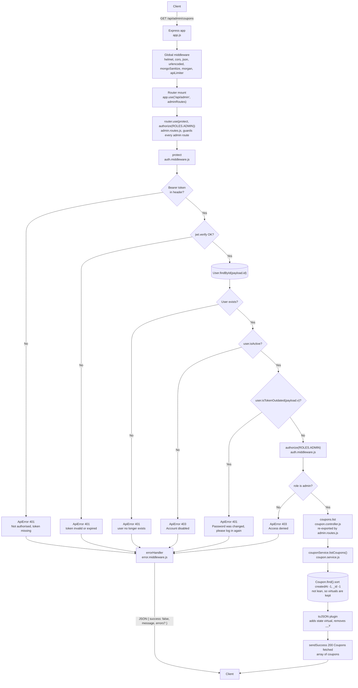

# List all coupons (admin) – `GET /api/admin/coupons`

An admin gets every coupon, newest first, each with its computed `state`. Same handler as `GET /api/coupons`, mounted here as an alias. Only admins may call it.

**Files involved:** `server/src/app.js` (global middleware, mounts `/api/admin`), `server/src/modules/admin/admin.routes.js` (route, `router.use(protect, authorize(ROLES.ADMIN))`, middleware order), `server/src/middleware/auth.middleware.js` (`protect`, `authorize`), `server/src/modules/coupons/coupon.controller.js`, `server/src/modules/coupons/coupon.service.js`, `server/src/modules/coupons/coupon.model.js` (schema validators, unique index on `code`), `server/src/utils/ApiResponse.js` (`sendSuccess`), `server/src/db/plugins/toJSON.js` (virtuals), `server/src/middleware/error.middleware.js` (error response).
