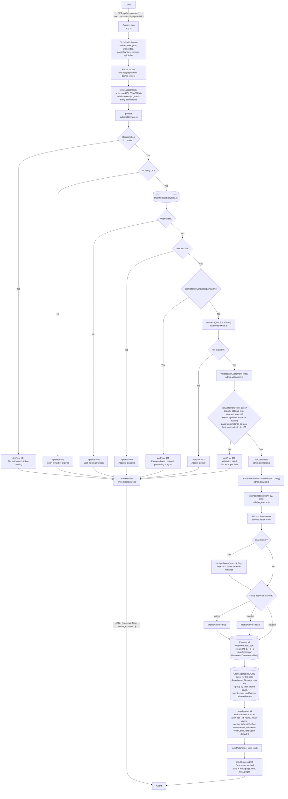

# List customers (admin) – `GET /api/admin/users`

An admin lists customer accounts (never admins), newest first, paginated (default 20, max 100), searchable by name or email and filterable by active or inactive. Each row carries the customer's order count and money spent on delivered orders, fetched with one extra aggregation for the whole page. Only admins may call it.

**Files involved:** `server/src/app.js` (global middleware, mounts `/api/admin`), `server/src/modules/admin/admin.routes.js` (route, `router.use(protect, authorize(ROLES.ADMIN))`, middleware order), `server/src/middleware/auth.middleware.js` (`protect`, `authorize`), `server/src/middleware/validate.middleware.js` (`validate`), `server/src/modules/admin/admin.validation.js` (`listCustomersRules`), `server/src/modules/admin/admin.controller.js` (`listCustomers`), `server/src/modules/admin/admin.service.js` (`listCustomers`, `escapeRegex`), `server/src/utils/pagination.js` (`getPagination`, `buildMeta`), `server/src/config/constants.js` (`PAGINATION`, `ROLES`, `ORDER_STATUS`), `server/src/modules/users/user.model.js`, `server/src/modules/orders/order.model.js` (queried), `server/src/utils/ApiResponse.js` (`sendSuccess`), `server/src/middleware/error.middleware.js` (error response).
