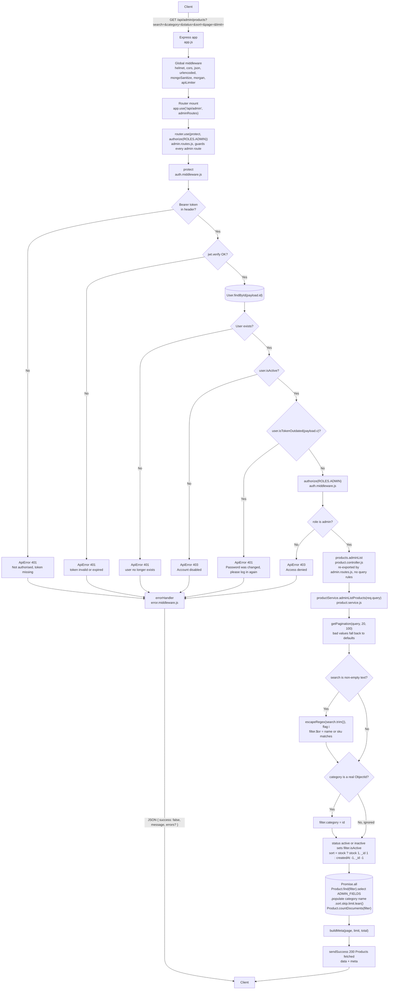

# List all products (admin) – `GET /api/admin/products`

An admin lists ALL products (inactive ones too) for the admin table: search by name or SKU, filter by category id and status, sort by lowest stock or newest, paginated (default 20, max 100). Invalid filter values are ignored, not refused. The handler belongs to the products module and is mounted under `/api/admin`. Only admins may call it.

**Files involved:** `server/src/app.js` (global middleware, mounts `/api/admin`), `server/src/modules/admin/admin.routes.js` (route, `router.use(protect, authorize(ROLES.ADMIN))`, middleware order), `server/src/middleware/auth.middleware.js` (`protect`, `authorize`), `server/src/modules/products/product.controller.js` (`adminList`), `server/src/modules/products/product.service.js` (`adminListProducts`, `ADMIN_FIELDS`, `ADMIN_PAGE`), `server/src/modules/products/product.query.js` (`escapeRegex`), `server/src/utils/pagination.js` (`getPagination`, `buildMeta`), `server/src/modules/products/product.model.js` (queried), `server/src/utils/ApiResponse.js` (`sendSuccess`), `server/src/middleware/error.middleware.js` (error response).
