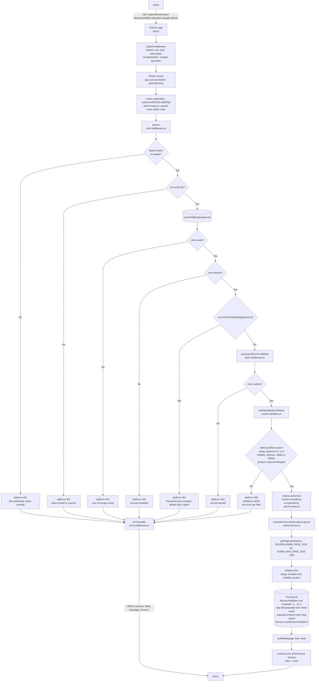

# Review moderation list (admin) – `GET /api/admin/reviews`

An admin lists all reviews (visible and hidden) for moderation, newest first, paginated (default 20, max 100), filterable by rating, visibility and product, with the reviewer's email and the product name. Same handler as `GET /api/reviews/admin`, mounted here as an alias. Only admins may call it.

**Files involved:** `server/src/app.js` (global middleware, mounts `/api/admin`), `server/src/modules/admin/admin.routes.js` (route, `router.use(protect, authorize(ROLES.ADMIN))`, middleware order), `server/src/middleware/auth.middleware.js` (`protect`, `authorize`), `server/src/middleware/validate.middleware.js` (`validate`), `server/src/modules/reviews/review.validation.js` (`adminListRules`), `server/src/modules/reviews/review.controller.js` (`adminList`), `server/src/modules/reviews/review.service.js` (`adminList`), `server/src/utils/pagination.js` (`getPagination`, `buildMeta`), `server/src/config/constants.js` (`REVIEW`), `server/src/modules/reviews/review.model.js` (queried), `server/src/utils/ApiResponse.js` (`sendSuccess`), `server/src/middleware/error.middleware.js` (error response).
