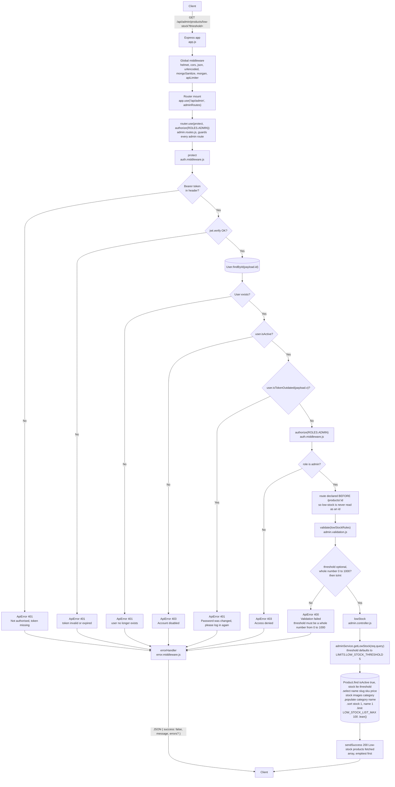

# Low-stock products (admin) – `GET /api/admin/products/low-stock`

An admin lists the active products whose stock is at or below a threshold (`?threshold`, default 5), emptiest first and capped at 100 rows: what to re-order today. This is the only low-stock route (the products module's own `lowStock` handler is not mounted). Only admins may call it.

**Files involved:** `server/src/app.js` (global middleware, mounts `/api/admin`), `server/src/modules/admin/admin.routes.js` (route, `router.use(protect, authorize(ROLES.ADMIN))`, middleware order), `server/src/middleware/auth.middleware.js` (`protect`, `authorize`), `server/src/middleware/validate.middleware.js` (`validate`), `server/src/modules/admin/admin.validation.js` (`lowStockRules`), `server/src/modules/admin/admin.controller.js` (`lowStock`), `server/src/modules/admin/admin.service.js` (`getLowStock`), `server/src/config/constants.js` (`LIMITS.LOW_STOCK_THRESHOLD`, `ADMIN_REPORTS.LOW_STOCK_LIST_MAX`), `server/src/modules/products/product.model.js` (queried), `server/src/utils/ApiResponse.js` (`sendSuccess`), `server/src/middleware/error.middleware.js` (error response).
