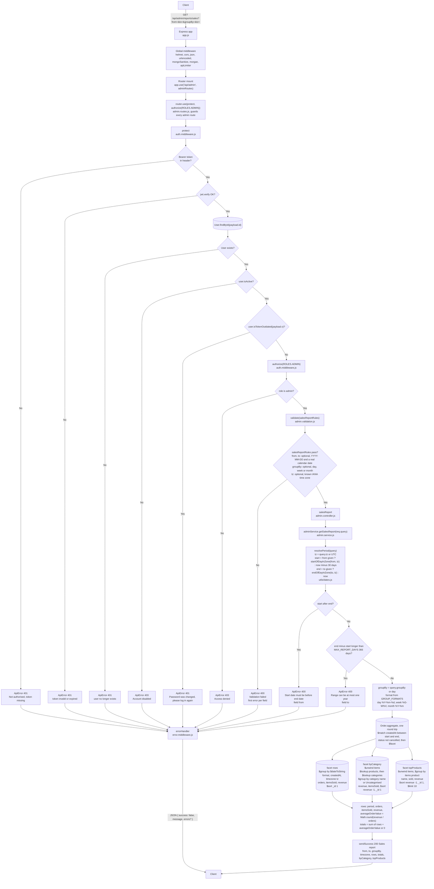

# Sales report (admin) – `GET /api/admin/reports/sales`

An admin gets the sales (every order that was NOT cancelled) of a period of calendar days in a chosen time zone, grouped by day, ISO week or month, with grand totals, average order value, revenue per category and the top 10 products. No `from` means the last 30 days, no `to` means now, and the period may be at most 366 days. Only admins may call it.

**Files involved:** `server/src/app.js` (global middleware, mounts `/api/admin`), `server/src/modules/admin/admin.routes.js` (route, `router.use(protect, authorize(ROLES.ADMIN))`, middleware order), `server/src/middleware/auth.middleware.js` (`protect`, `authorize`), `server/src/middleware/validate.middleware.js` (`validate`), `server/src/modules/admin/admin.validation.js` (`salesReportRules`, `dayRule`, `tzRule`), `server/src/utils/dates.js` (`isValidTimeZone`, `startOfDayInZone`, `endOfDayInZone`, `DAY_MS`), `server/src/config/constants.js` (`ADMIN_REPORTS`, `ORDER_STATUS`), `server/src/modules/admin/admin.controller.js` (`salesReport`), `server/src/modules/admin/admin.service.js` (`getSalesReport`, `resolvePeriod`), `server/src/modules/orders/order.model.js` (aggregated), `server/src/utils/ApiResponse.js` (`sendSuccess`), `server/src/middleware/error.middleware.js` (error response).
