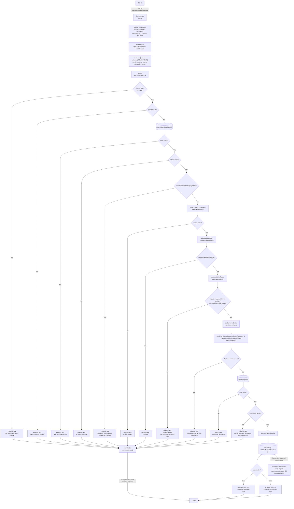

# Activate or deactivate a customer (admin) – `PATCH /api/admin/users/:id/status`

An admin switches a customer account on or off with `{ isActive: true|false }`. An admin cannot change their own status and admin accounts cannot be changed here. A deactivated customer is locked out at once, because `protect` reloads the user on every request. Only admins may call it.

**Files involved:** `server/src/app.js` (global middleware, mounts `/api/admin`), `server/src/modules/admin/admin.routes.js` (route, `router.use(protect, authorize(ROLES.ADMIN))`, middleware order), `server/src/middleware/auth.middleware.js` (`protect`, `authorize`), `server/src/middleware/validate.middleware.js` (`validateObjectId`, `validate`), `server/src/modules/admin/admin.validation.js` (`statusRules`), `server/src/modules/admin/admin.controller.js` (`setCustomerStatus`), `server/src/modules/admin/admin.service.js` (`setCustomerStatus`), `server/src/config/constants.js` (`ROLES`), `server/src/modules/users/user.model.js` (saved), `server/src/utils/ApiResponse.js` (`sendSuccess`), `server/src/middleware/error.middleware.js` (error response).
