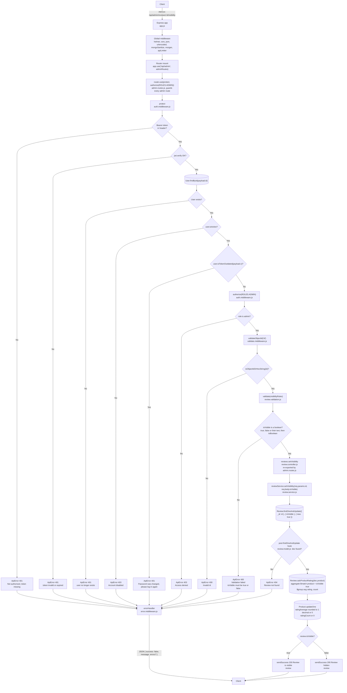

# Hide or show a review (admin) – `PATCH /api/admin/reviews/:id/visibility`

An admin hides or shows a review with `{ isVisible }`. The model's post hook recalculates the product's rating average and count from the visible reviews before the answer is sent. Same handler as `PATCH /api/reviews/:id/visibility`, mounted here as an alias. Only admins may call it.

**Files involved:** `server/src/app.js` (global middleware, mounts `/api/admin`), `server/src/modules/admin/admin.routes.js` (route, `router.use(protect, authorize(ROLES.ADMIN))`, middleware order), `server/src/middleware/auth.middleware.js` (`protect`, `authorize`), `server/src/middleware/validate.middleware.js` (`validateObjectId`, `validate`), `server/src/modules/reviews/review.validation.js` (`visibilityRules`), `server/src/modules/reviews/review.controller.js` (`setVisibility`), `server/src/modules/reviews/review.service.js` (`setVisibility`), `server/src/modules/reviews/review.model.js` (post `findOneAndUpdate` hook, `calcProductRating`), `server/src/modules/products/product.model.js` (rating fields), `server/src/utils/ApiResponse.js` (`sendSuccess`), `server/src/middleware/error.middleware.js` (error response).
