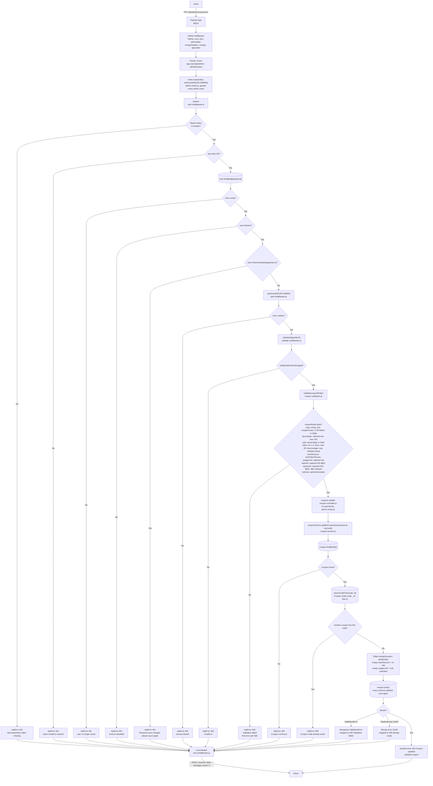

# Update a coupon (admin) – `PUT /api/admin/coupons/:id`

An admin replaces a coupon's settings. Same handler and rules as `PUT /api/coupons/:id`, mounted here as an alias: the code must stay unique among other coupons, only whitelisted fields are copied, and `usedCount` and `createdBy` can never change. Only admins may call it.

**Files involved:** `server/src/app.js` (global middleware, mounts `/api/admin`), `server/src/modules/admin/admin.routes.js` (route, `router.use(protect, authorize(ROLES.ADMIN))`, middleware order), `server/src/middleware/auth.middleware.js` (`protect`, `authorize`), `server/src/middleware/validate.middleware.js` (`validateObjectId`, `validate`), `server/src/modules/coupons/coupon.validation.js` (`couponRules`), `server/src/modules/coupons/coupon.controller.js`, `server/src/modules/coupons/coupon.service.js`, `server/src/modules/coupons/coupon.model.js` (schema validators, unique index on `code`), `server/src/utils/ApiResponse.js` (`sendSuccess`), `server/src/middleware/error.middleware.js` (error response) (ValidationError to 400, 11000 to 409).
