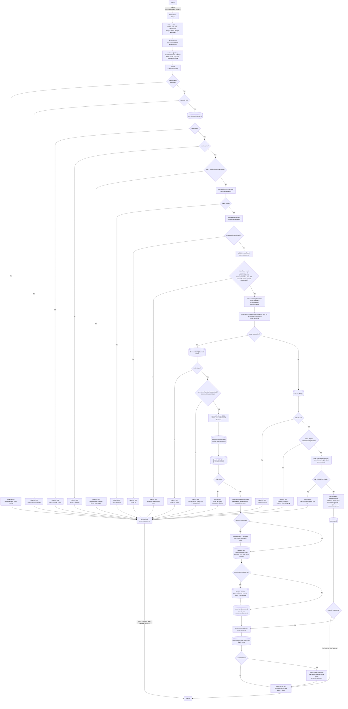

# Update order status (admin) – `PATCH /api/admin/orders/:id/status`

An admin moves an order along the state machine (BR-08). Cancelling runs a transaction that restores stock and the coupon use and marks a paid order as refunded; shipping needs a tracking number; delivering a Cash on Delivery order marks it paid. The customer is emailed about every change except `processing`. Since branch 10 the route lives in the admin router (`admin.routes.js`) and reuses the orders module's controller; the URL is unchanged. Only admins may call it.

**Files involved:** `server/src/app.js` (global middleware, mounts `/api/admin`), `server/src/modules/admin/admin.routes.js` (route, `router.use(protect, authorize(ROLES.ADMIN))`, middleware order), `server/src/middleware/auth.middleware.js` (`protect`, `authorize`), `server/src/middleware/validate.middleware.js` (`validateObjectId`, `validate`), `server/src/modules/orders/order.validation.js` (`statusRules`), `server/src/modules/orders/order.controller.js` (`adminUpdateStatus`), `server/src/modules/orders/order.service.js` (`adminUpdateStatus`, `cancelWithRestore`, `sendOrderEmail`), `server/src/modules/orders/order.model.js` (`canTransitionTo`, `changeStatus`), `server/src/config/constants.js` (`ORDER_STATUS`, `ORDER_TRANSITIONS`, `PAYMENT_STATUS`), `server/src/modules/products/product.model.js` (`releaseStock`), `server/src/modules/coupons/coupon.model.js` (`release`), `server/src/emails/sendEmail.js`, `server/src/emails/templates.js` (`orderStatusTemplate`), `server/src/utils/ApiResponse.js` (`sendSuccess`), `server/src/middleware/error.middleware.js` (error response).
