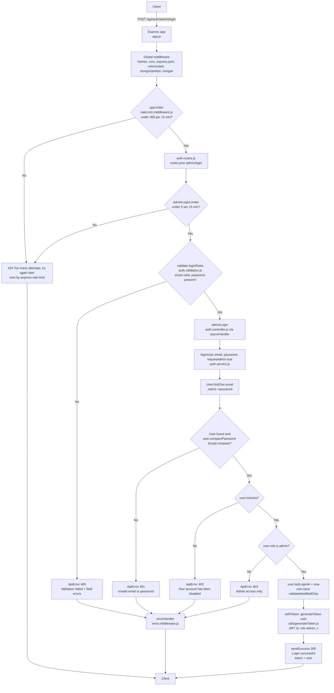

# Admin login – `POST /api/auth/admin/login`

Same email and password check as user login, but only accounts with role `admin` get a token, and the rate limit is stricter. Public endpoint for the admin panel.

**Files involved:** `server/src/app.js` (global middleware, mounts `/api/auth`), `server/src/middleware/rateLimit.middleware.js` (apiLimiter, adminLoginLimiter), `server/src/modules/auth/auth.routes.js` (route pipeline), `server/src/middleware/validate.middleware.js` (runs rules), `server/src/modules/auth/auth.validation.js` (loginRules), `server/src/modules/auth/auth.controller.js` (adminLogin), `server/src/modules/auth/auth.service.js` (loginUser with requireAdmin), `server/src/modules/users/user.model.js` (comparePassword), `server/src/utils/generateToken.js` (JWT), `server/src/utils/ApiResponse.js` (sendSuccess), `server/src/utils/ApiError.js`, `server/src/middleware/error.middleware.js` (error JSON).
