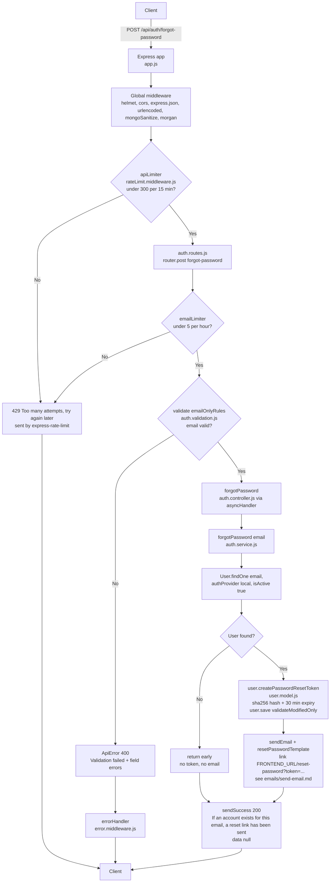

# Forgot password – `POST /api/auth/forgot-password`

Emails a password-reset link to an active email+password account. Public; always answers with the same 200 message whether or not the email exists, so it cannot be used to discover accounts.

**Files involved:** `server/src/app.js` (global middleware, mounts `/api/auth`), `server/src/middleware/rateLimit.middleware.js` (apiLimiter, emailLimiter), `server/src/modules/auth/auth.routes.js` (route pipeline), `server/src/middleware/validate.middleware.js` (runs rules), `server/src/modules/auth/auth.validation.js` (emailOnlyRules), `server/src/modules/auth/auth.controller.js` (forgotPassword), `server/src/modules/auth/auth.service.js` (forgotPassword), `server/src/modules/users/user.model.js` (createPasswordResetToken), `server/src/config/constants.js` (TOKEN_TTL), `server/src/emails/sendEmail.js` + `server/src/emails/templates.js` (reset email), `server/src/utils/ApiResponse.js` (sendSuccess), `server/src/utils/ApiError.js`, `server/src/middleware/error.middleware.js` (error JSON).
