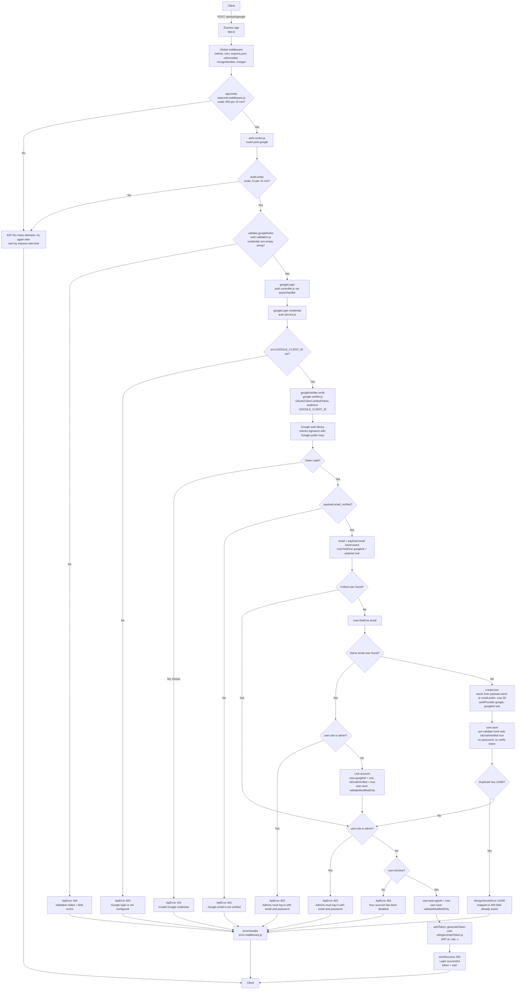

# Google login – `POST /api/auth/google`

Signs a customer in (or signs them up) with the ID token from Google's sign-in button: verifies it with Google, then finds, links or creates the user and returns a JWT. Public (rate limited); admins are refused.

**Files involved:** `server/src/app.js` (global middleware, mounts `/api/auth`), `server/src/middleware/rateLimit.middleware.js` (apiLimiter, authLimiter), `server/src/modules/auth/auth.routes.js` (route pipeline), `server/src/middleware/validate.middleware.js` (runs rules), `server/src/modules/auth/auth.validation.js` (googleRules), `server/src/modules/auth/auth.controller.js` (googleLogin), `server/src/modules/auth/auth.service.js` (googleLogin, createUser), `server/src/modules/auth/google.verifier.js` (Google ID token check via google-auth-library), `server/src/modules/users/user.model.js` (pre-validate googleVerified hook), `server/src/config/env.js` (GOOGLE_CLIENT_ID), `server/src/utils/generateToken.js` (JWT), `server/src/utils/ApiResponse.js` (sendSuccess), `server/src/utils/ApiError.js`, `server/src/middleware/error.middleware.js` (error JSON; 500 message hidden in production).
