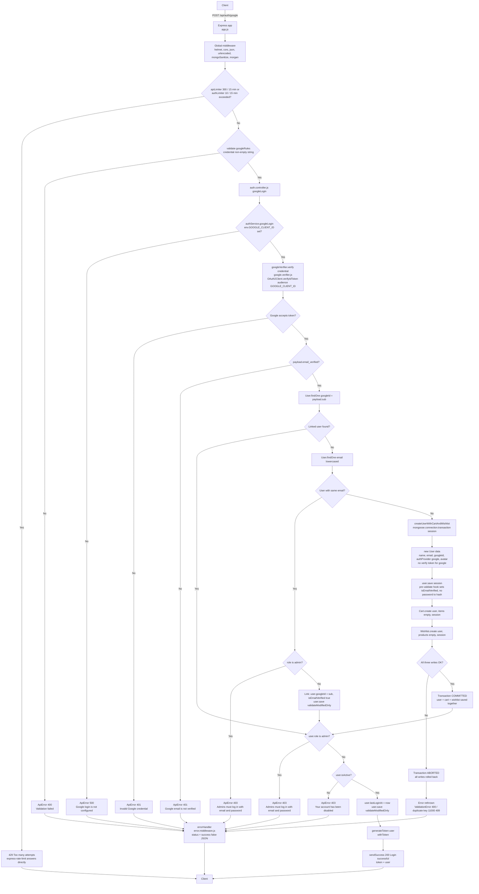

# Google sign-in / sign-up – `POST /api/auth/google`

Public sign-in with a Google ID token. Finds the user by Google id, links an existing email account, or creates a new customer; since branch 05 a new Google customer is created together with an empty cart and wishlist in ONE MongoDB transaction. Admins are refused.

**Files involved:** `server/src/app.js` (mounts /api/auth, apiLimiter), `server/src/modules/auth/auth.routes.js` (authLimiter, validate), `server/src/middleware/rateLimit.middleware.js` (authLimiter), `server/src/modules/auth/auth.validation.js` (googleRules), `server/src/modules/auth/auth.controller.js` (googleLogin, withToken), `server/src/modules/auth/auth.service.js` (googleLogin, createUserWithCartAndWishlist transaction), `server/src/modules/auth/google.verifier.js` (Google OAuth2Client), `server/src/modules/users/user.model.js` (User, googleVerified pre-validate hook), `server/src/modules/cart/cart.model.js` (Cart), `server/src/modules/wishlist/wishlist.model.js` (Wishlist), `server/src/utils/generateToken.js` (JWT), `server/src/middleware/error.middleware.js` (errorHandler)
