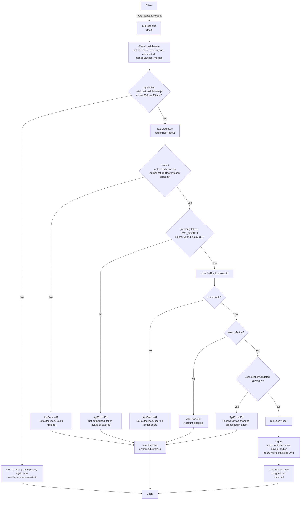

# Logout – `POST /api/auth/logout`

Confirms logout for a logged-in user. JWTs are stateless, so the server deletes nothing: the client simply drops its token. Requires a valid Bearer token.

**Files involved:** `server/src/app.js` (global middleware, mounts `/api/auth`), `server/src/middleware/rateLimit.middleware.js` (apiLimiter), `server/src/modules/auth/auth.routes.js` (route pipeline), `server/src/middleware/auth.middleware.js` (protect), `server/src/modules/users/user.model.js` (isTokenOutdated), `server/src/modules/auth/auth.controller.js` (logout), `server/src/utils/ApiResponse.js` (sendSuccess), `server/src/utils/ApiError.js`, `server/src/middleware/error.middleware.js` (error JSON).
