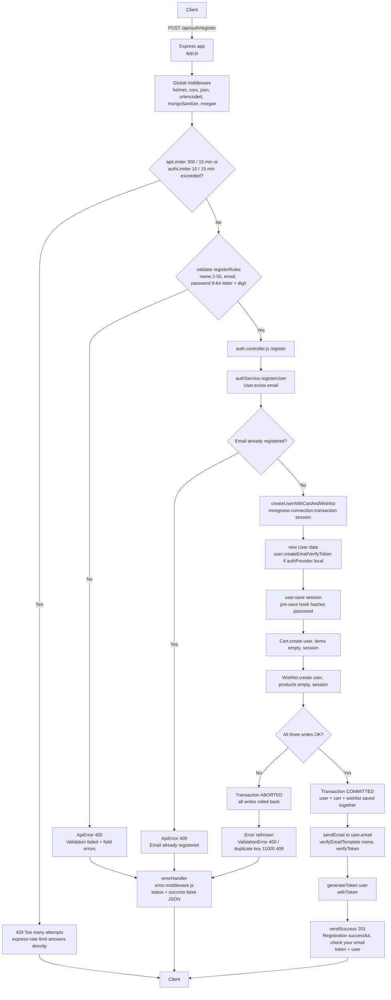

# Register customer – `POST /api/auth/register`

Public sign-up with name, email and password. Always creates a `customer`, and since branch 05 creates the user, an empty cart and an empty wishlist in ONE MongoDB transaction (all or nothing), then emails a verification link.

**Files involved:** `server/src/app.js` (mounts /api/auth, apiLimiter), `server/src/modules/auth/auth.routes.js` (authLimiter, validate), `server/src/middleware/rateLimit.middleware.js` (authLimiter), `server/src/middleware/validate.middleware.js` (validate), `server/src/modules/auth/auth.validation.js` (registerRules), `server/src/modules/auth/auth.controller.js` (register, withToken), `server/src/modules/auth/auth.service.js` (registerUser, createUserWithCartAndWishlist transaction), `server/src/modules/users/user.model.js` (password hash hook, createEmailVerifyToken), `server/src/modules/cart/cart.model.js` (Cart), `server/src/modules/wishlist/wishlist.model.js` (Wishlist), `server/src/emails/sendEmail.js` + `server/src/emails/templates.js` (verifyEmailTemplate), `server/src/utils/generateToken.js` (JWT), `server/src/middleware/error.middleware.js` (errorHandler)
