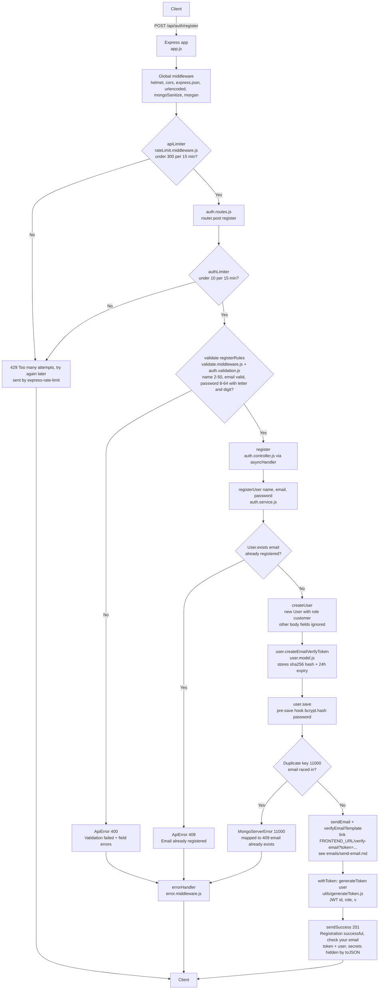

# Register – `POST /api/auth/register`

Creates a new customer account with name, email and password, emails a verification link and returns a login token. Public: anyone may call it (rate limited).

**Files involved:** `server/src/app.js` (global middleware, mounts `/api/auth`), `server/src/middleware/rateLimit.middleware.js` (apiLimiter, authLimiter), `server/src/modules/auth/auth.routes.js` (route pipeline), `server/src/middleware/validate.middleware.js` (runs rules), `server/src/modules/auth/auth.validation.js` (registerRules, passwordRule), `server/src/modules/auth/auth.controller.js` (register, withToken), `server/src/modules/auth/auth.service.js` (registerUser, createUser), `server/src/modules/users/user.model.js` (createEmailVerifyToken, pre-save hash), `server/src/emails/sendEmail.js` + `server/src/emails/templates.js` (verification email), `server/src/utils/generateToken.js` (JWT), `server/src/utils/ApiResponse.js` (sendSuccess), `server/src/utils/ApiError.js`, `server/src/middleware/error.middleware.js` (error JSON, 11000 to 409).
