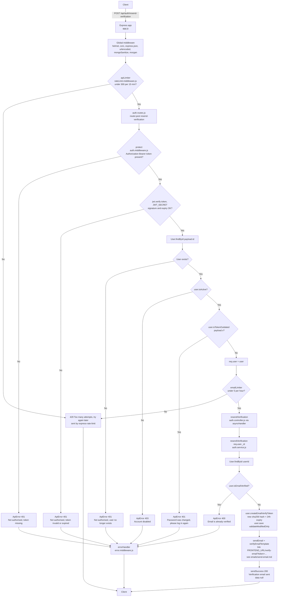

# Resend verification email – `POST /api/auth/resend-verification`

Creates a new email-verification token (replacing the old one) and emails a fresh link. Logged-in users only; limited to 5 emails per hour.

**Files involved:** `server/src/app.js` (global middleware, mounts `/api/auth`), `server/src/middleware/rateLimit.middleware.js` (apiLimiter, emailLimiter), `server/src/modules/auth/auth.routes.js` (route pipeline: protect then emailLimiter), `server/src/middleware/auth.middleware.js` (protect), `server/src/modules/auth/auth.controller.js` (resendVerification), `server/src/modules/auth/auth.service.js` (resendVerification), `server/src/modules/users/user.model.js` (createEmailVerifyToken, isTokenOutdated), `server/src/emails/sendEmail.js` + `server/src/emails/templates.js` (verification email), `server/src/utils/ApiResponse.js` (sendSuccess), `server/src/utils/ApiError.js`, `server/src/middleware/error.middleware.js` (error JSON).
