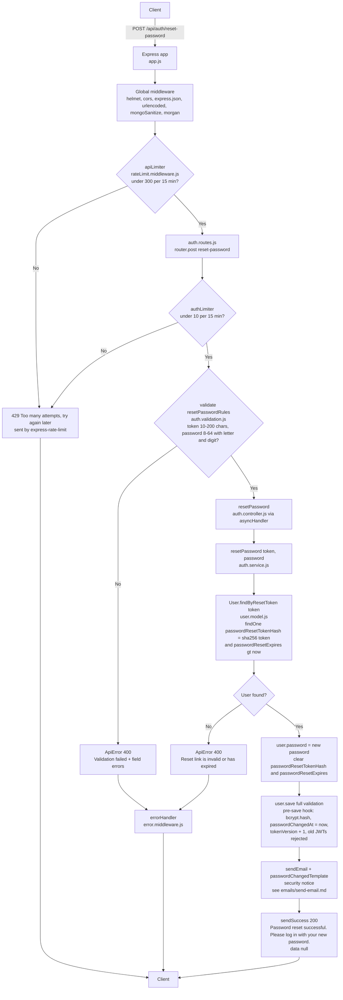

# Reset password – `POST /api/auth/reset-password`

Sets a new password using the single-use token from the reset email, which also logs out every existing session, then sends a security notice. Public (rate limited); returns no token, so the user logs in again.

**Files involved:** `server/src/app.js` (global middleware, mounts `/api/auth`), `server/src/middleware/rateLimit.middleware.js` (apiLimiter, authLimiter), `server/src/modules/auth/auth.routes.js` (route pipeline), `server/src/middleware/validate.middleware.js` (runs rules), `server/src/modules/auth/auth.validation.js` (resetPasswordRules = tokenRules + passwordRule), `server/src/modules/auth/auth.controller.js` (resetPassword), `server/src/modules/auth/auth.service.js` (resetPassword), `server/src/modules/users/user.model.js` (findByResetToken, pre-save hash, tokenVersion), `server/src/emails/sendEmail.js` + `server/src/emails/templates.js` (password changed notice), `server/src/utils/ApiResponse.js` (sendSuccess), `server/src/utils/ApiError.js`, `server/src/middleware/error.middleware.js` (error JSON).
