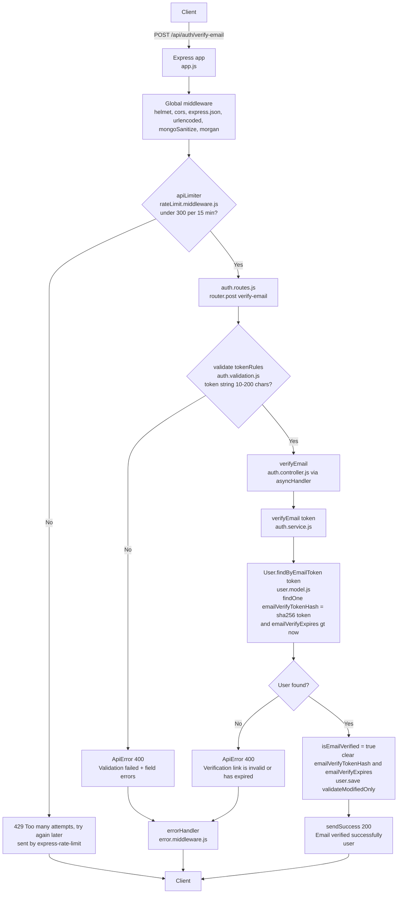

# Verify email – `POST /api/auth/verify-email`

Marks the account's email as verified using the single-use token from the verification email. Public: the user arrives from the link in their mailbox (the frontend page posts the token).

**Files involved:** `server/src/app.js` (global middleware, mounts `/api/auth`), `server/src/middleware/rateLimit.middleware.js` (apiLimiter), `server/src/modules/auth/auth.routes.js` (route pipeline, no extra limiter), `server/src/middleware/validate.middleware.js` (runs rules), `server/src/modules/auth/auth.validation.js` (tokenRules), `server/src/modules/auth/auth.controller.js` (verifyEmail), `server/src/modules/auth/auth.service.js` (verifyEmail), `server/src/modules/users/user.model.js` (findByEmailToken, sha256), `server/src/utils/ApiResponse.js` (sendSuccess), `server/src/utils/ApiError.js`, `server/src/middleware/error.middleware.js` (error JSON).
