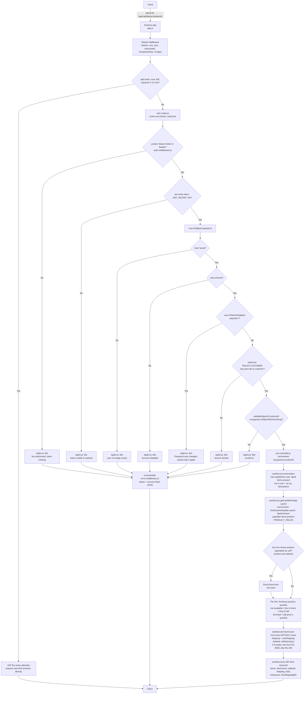

# Remove item from cart – `DELETE /api/cart/items/:productId`

Removes one product line from the logged-in customer's cart with an atomic `$pull`. Removing a product that is not in the cart is not an error (idempotent). Customers only.

**Files involved:** `server/src/app.js` (mounts /api/cart, apiLimiter), `server/src/modules/cart/cart.routes.js` (protect + authorize customer for every route), `server/src/middleware/auth.middleware.js` (protect, authorize), `server/src/middleware/validate.middleware.js` (validateObjectId), `server/src/modules/cart/cart.controller.js` (thin controller, sendSuccess), `server/src/modules/cart/cart.service.js` (business rules, getCartWithTotals), `server/src/modules/cart/cart.model.js` (Cart schema, Cart.forUser upsert), `server/src/utils/pricing.js` (calcShipping), `server/src/config/constants.js` (LIMITS.MAX_CART_QTY, PRICING), `server/src/middleware/error.middleware.js` (errorHandler)
