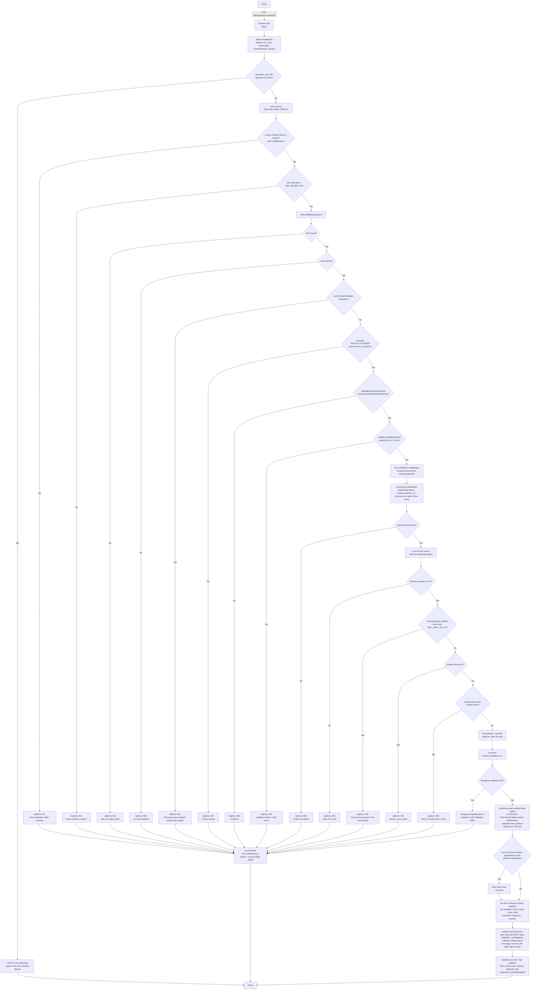

# Update cart item quantity – `PUT /api/cart/items/:productId`

Sets (replaces) the quantity of a product that is already in the logged-in customer's cart, checking the 10-per-product limit and the current stock. Customers only.

**Files involved:** `server/src/app.js` (mounts /api/cart, apiLimiter), `server/src/modules/cart/cart.routes.js` (protect + authorize customer for every route), `server/src/middleware/auth.middleware.js` (protect, authorize), `server/src/middleware/validate.middleware.js` (validateObjectId, validate), `server/src/modules/cart/cart.validation.js` (updateItemRules), `server/src/modules/cart/cart.controller.js` (thin controller, sendSuccess), `server/src/modules/cart/cart.service.js` (business rules, getCartWithTotals), `server/src/modules/cart/cart.model.js` (Cart schema, Cart.forUser upsert), `server/src/utils/pricing.js` (calcShipping), `server/src/config/constants.js` (LIMITS.MAX_CART_QTY, PRICING), `server/src/middleware/error.middleware.js` (errorHandler)
